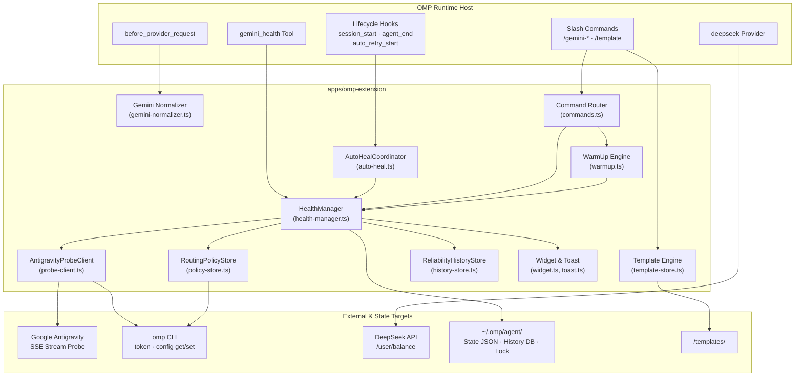

# OMP Extension

`@omp-toolkit/omp-extension` is the OMP runtime extension and standalone CLI daemon for the OMP Toolkit. The entry point at `src/index.ts` serves as both the extension factory for active OMP sessions and the CLI router when executed directly with Bun.

The extension monitors Google Antigravity Gemini routes (`gemini-3.8-flash*`), detects route hangs, and temporarily excludes hung accounts by setting `reservePct: 100` in OMP's `auth.accountPolicies`. When excluded accounts pass consecutive spaced health checks, the extension automatically restores them. In addition to route health, the extension provides an in-session TUI health widget, account warm-up and unhang diagnostics, transparent Gemini wire request normalization, DeepSeek balance telemetry, local 30-day reliability audit logging, OS desktop incident alerts, and `/template` management for global `AGENTS.md` and `RULES.md` bundles.

Health probes issue lightweight streaming model requests directly to Google Antigravity using OMP OAuth tokens. Probes run only from explicit user commands, the `gemini_health` tool, CLI commands, session startup, error-triggered auto-heal, desktop actions, or the idle recovery timer. The passive terminal monitor (`apps/provider-usage`) only reads cached snapshots and never probes models.

> [!WARNING]
> Healing changes OMP account routing policies. Exclusions are temporary and tracked in local state files, but always review dry-run output (`/gemini-heal --dry-run`) before applying exclusions in an unfamiliar setup.

---

## Features at a glance

| Feature | What it does | Trigger |
| :--- | :--- | :--- |
| **Route probing** | Classifies every Antigravity account as `OK`, `HANG`, `ERR`, `AUTH`, or `MODEL` | Slash commands, tool, CLI, startup, failure hooks, idle recovery |
| **Circuit breaker** | Temporarily excludes minority failing accounts with `reservePct: 100` | `/gemini-heal`, `gemini_health` with `heal: true`, auto-heal |
| **Streak auto-restore** | Restores managed exclusions after consecutive spaced healthy checks | Any full health probe recording results; idle recovery sweeper |
| **TUI widget** | Shows account status, latency, exclusions, and restore progress below the editor | Active TUI session startup and health updates |
| **Warm-up and check** | Sends a minimal probe; warm-up respects eligibility/cooldown, check bypasses both | `/gemini-warmup`, `/gemini-check`, CLI, desktop |
| **Wire normalizer** | Cleans selected historical Gemini turns and fixes safe trailing assistant/model turns | Outgoing Gemini requests |
| **DeepSeek telemetry** | Reports DeepSeek balance through a registered OMP provider | OMP usage requests (`api.deepseek.com/user/balance`) |
| **Prompt templates** | Saves, applies, lists, compares, and deletes named global `AGENTS.md` + `RULES.md` bundles | `/template` slash command |
| **Reliability history** | Stores local health, policy, incident, session, and agent-run events for 30 days | Ongoing extension activity (`omp-toolkit-history.db`) |
| **OS notifications** | Sends throttled desktop alerts for provider-wide and operational incidents | Incident creation (throttled to 15m per kind) |
| **Standalone CLI** | Runs probes, watch mode, warm-up, and checks outside an OMP session | Terminal execution or desktop Electron subprocess |

---

## How it works

### Architecture



`AntigravityHealthManager` is the domain coordinator for probing, policy updates, streak calculation, snapshot persistence, incidents, and SQLite history recording. Pure domain scheduling, types, and path resolvers are imported from `@omp-toolkit/core`. For a sequence diagram of the circuit-breaker flow, see [docs/architecture.md](../../docs/architecture.md#health-data-flow).

### Route-health lifecycle

1. **Load accounts:** Discovers Antigravity accounts by joining OMP usage metadata (`omp usage --provider google-antigravity --json`) with token list indexes (`omp token google-antigravity --list`).
2. **Probe accounts:** Issues a minimal streaming request (max 8 output tokens, 15s attempt deadline) for the designated probe model (`gemini-3.8-flash-high`) to Google Antigravity for each account concurrently. Evidence is recorded per route: provider, account email, project, and model.
3. **Record snapshot:** Persists results and healthy streaks atomically into `gemini-health-latest.json`, evaluates provider-wide failure states, updates the TUI widget, and logs audit events to SQLite. Earlier observations never overwrite newer ones.
4. **Heal hung accounts:** When healing is triggered (manually or via auto-heal), a *confirmed* retryable failure (`HANG`/timeout or `ERR`/transient) is excluded only when a different, non-excluded account has a fresh `OK` on the same probe model. The exclusion is the canonical `{ provider: "google-antigravity", account: { email }, reservePct: 100 }` entry.
5. **Track managed state:** Excluded accounts are recorded in `gemini-health-state.json` with a pending intent written before the policy and promoted after it lands. Existing user policies — including partial `reservePct` — are never edited or claimed.
6. **Streak auto-restore:** On subsequent healthy probes, accounts that reach `RESTORE_STREAK` (default 3) consecutive healthy checks spaced at least `RESTORE_GAP_MS` (default 60s) apart are automatically un-excluded, provided the streak is still fresh. Manual exclusions restore automatically only if opted in via `/gemini-auto-restore`, and only their exclusion reservation is removed.
7. **Session reload:** Triggers OMP's session reload API when available. Pinned sessions may require `/new` or a restart for routing changes to take effect.

| Status | Meaning in this extension |
| :--- | :--- |
| `OK` | The model emitted non-empty text and its candidate reported a successful terminal `finishReason` (`STOP`/`MAX_TOKENS`) |
| `HANG` | No completed model output within the 15-second attempt deadline after the stream was accepted |
| `ERR` | Rate limit, transient upstream failure, network failure, or unparseable/blocked stream payload (never an excludable failure except transient) |
| `AUTH` | OAuth token acquisition failed, or HTTP/in-band 401/403 or `UNAUTHENTICATED`/`PERMISSION_DENIED` |
| `MODEL` | HTTP/in-band 404 or `NOT_FOUND` for the probe model |

A route whose latest observation is older than 15 minutes is reported as `STALE`; its last status stays visible as detail but is not treated as current evidence. Successful output on the probe model does not establish that other models work.


Probes use OMP-issued account OAuth Bearer tokens and a minimal wire request.

Warm-up and check both use this probe. Warm-up is route readiness, not a
quota-window control; whether the provider starts a 5-hour window on the request
is provider behavior the toolkit does not model.

---

## Requirements and installation

- **Bun** `>=1.4.3`
- **OMP** 18.12.5
- At least one configured Google Antigravity account
- `omp` CLI on system `PATH` (or configured via `OMP_BIN`)
- `DEEPSEEK_API_KEY` (optional, for DeepSeek balance queries)

### Monorepo build and install

From the repository checkout root:

```bash
bun install --frozen-lockfile
bun run install:omp
```

The installer builds the extension bundle to `apps/omp-extension/dist/index.js`, copies it to `~/.omp/agent/extensions/gemini-health.js`, installs `windows-toast.ps1` under `~/.omp/agent/scripts/`, creates timestamped backups in `~/.omp/agent/backups/`, and removes legacy `.ts` extension files.

To preview actions without modifying files:

```bash
bun scripts/install/install.ts --dry-run
```

### Verification

```bash
# Run one-shot health audit against active accounts (produces JSON snapshot)
bun ~/.omp/agent/extensions/gemini-health.js --json

# Run argument validation smoke test (no network; exits 1 with usage help)
bun apps/omp-extension/src/index.ts --warmup
```

On Windows, replace `~` with `$HOME` or run through PowerShell. For complete workstation installation, see the [Root Quick Start](../../README.md#quick-start).

---

## Slash commands

### Gemini health commands

| Command | Purpose | Important behavior |
| :--- | :--- | :--- |
| `/gemini-health-widget [on\|off]` | Show, hide, or toggle the TUI widget | Without arguments, toggles visibility. Hiding clears the widget display but keeps commands available. Health execution follows `GEMINI_HEALTH_ENABLED`; enabling the widget while paused does not start a check. |
| `/gemini-health [--confirm]` | Probe all Antigravity accounts | Probes all accounts and prints the tabular status in chat. `--confirm` re-probes failing accounts after a 1s pause. Records snapshot, updates streaks, and executes streak auto-restore. |
| `/gemini-warmup <email-or-local-part>` | Warm one eligible account | Sends an 8-token generation ping to keep the route warm. Skips accounts whose latest check is not `OK`. Enforces a 60s per-account cooldown. |
| `/gemini-warmup --all` | Warm all eligible accounts | Sequentially warms all `OK` accounts with a 1s pause between requests. Skips non-OK and cooling-down accounts. Cannot be combined with an account name. |
| `/gemini-check <email-or-local-part>` | Single-account unhang check | Probes a specific account route to see if it recovered. Bypasses warm-up eligibility and 60s cooldown. Merges the result into the latest snapshot. |
| `/gemini-heal [--dry-run]` | Exclude hung accounts | Probes all accounts with confirmation. Excludes failing accounts with `reservePct: 100` if they are a minority. Aborts if 100% of accounts fail. `--dry-run` logs and notifies without updating policies. |
| `/gemini-restore` | Restore managed exclusions | Removes only the exclusions applied by `/gemini-heal` or auto-heal. Resets streaks for restored accounts and reloads session settings. |
| `/gemini-enable <email-or-local-part> [--force]` | Re-enable an account | Clears exclusion from `auth.accountPolicies` for any account. Requires `--force` if the latest check was not `OK`. Cleans managed state, streaks, and auto-restore opt-ins. |
| `/gemini-auto-restore` | List manual exclusion opt-ins | Without arguments, lists accounts opted into automatic streak restoration alongside currently excluded manual accounts. |
| `/gemini-auto-restore <email-or-local-part>` | Opt in manual exclusion | Enables streak-based auto-restore for a manually excluded account. Account must resolve to a live Antigravity account. |
| `/gemini-auto-restore off <email-or-local-part>` | Opt out manual exclusion | Disables auto-restore for an account. If an account was deleted upstream, matches by email or local-part in the sidecar to allow cleanup. |
| `/gateway [status\|start\|stop\|restart\|client-add\|recipe]` | Manage Auth Gateway & client PC tokens | `/gateway status` checks daemon and tunnel health, `/gateway start`/`stop` manages daemons, `/gateway client-add <name>` issues a scoped bearer token for a secondary PC, `/gateway recipe` prints client setup snippets. |

When `GEMINI_HEALTH_ENABLED` is not `1`, every `/gemini-*` command except `/gemini-health-widget` returns the pause explanation without resolving accounts, probing, or changing policies.

```text
/gemini-health --confirm
/gemini-heal --dry-run
/gemini-heal
/gemini-check alpha
/gemini-enable alpha@example.com
/gemini-auto-restore alpha@example.com
```

### Account resolution

Commands that accept `<email-or-local-part>` resolve identifiers using the following rules:
- Inputs are trimmed and compared case-insensitively.
- Exact email matches take top priority (`alpha@example.com`).
- Prefix matches compare the local-part before `@` (e.g., `alpha` matches `alpha@example.com`).
- If multiple accounts share the same local-part, the command halts with a warning showing matching emails; use the full email address to disambiguate.
- `/gemini-enable` resolves identifiers against live Antigravity accounts. If an account was removed upstream from Google OAuth, remove its policy manually via OMP config (`omp config set auth.accountPolicies ...`).
- Policy checks, streak keys, warm-up cooldowns, and auto-restore sidecar entries are matched case-insensitively.

### Prompt template commands

```text
/template save <name> [--force] | apply <name> | list | show <name> | delete <name> --force
/template help
```

- **Scope:** Manages global `AGENTS.md` and `RULES.md` prompt files in `~/.omp/agent/`. It does not manage `config.yml` or sub-agent rules.
- **Naming:** 1–64 characters matching `^[a-z0-9][a-z0-9-_]{0,63}$`, starting with a letter or digit.
- **Save:** Snapshots current live files into `<checkout>/templates/<name>/`. Requires `--force` to overwrite an existing template.
- **Apply:** Replaces live files with template contents. Live files missing from the template are removed. Creates a timestamped pre-apply backup in `~/.omp/agent/backups/`, automatically rolls back if writing fails, and attempts a session reload. Start `/new` to guarantee the prompt cache in the LLM context refreshes.
- **Retention:** Prunes template backup folders automatically on apply, retaining the **10 most recent backups**.
- **List & Show:** `list` lists all repository templates and marks matching live globals with `*`. `show` compares template files against live globals (`identical`, `differs`, `will create`, `will delete`).
- **Delete:** Deletes `<checkout>/templates/<name>/`. Strictly requires `--force`.

For complete template rules, see [templates/README.md](../../templates/README.md). Never save API keys, credentials, or confidential tokens into template files.

---

## Agent tool: `gemini_health`

The extension registers the `gemini_health` tool with OMP (`loadMode: "essential"`, `approval: "write"`), allowing coding agents to inspect route health and recover from hangs autonomously.

| Parameter | Type | Default | Effect |
| :--- | :--- | :--- | :--- |
| `heal` | `boolean` | `false` | When `true`, evaluates auto-restores and applies temporary `reservePct: 100` exclusions to hung accounts |
| `confirm` | `boolean` | `true` | When `true`, re-probes failing accounts after a 1s delay before returning or excluding |

The tool always checks all accounts, updates snapshots, and refreshes the TUI widget. It returns a plain-text tabular summary for the model prompt and structured telemetry in `details` (`results`, `restored`, and `action` when healing).

---

## Automatic behavior

Health execution is opt-in. Unless `GEMINI_HEALTH_ENABLED=1`, the extension performs no Gemini route probe or account-policy mutation: startup checks, the idle recovery sweeper, stall-triggered auto-heal, `/gemini-*` commands, the `gemini_health` tool, and CLI probes report the pause explanation instead. General session and agent-run history still records, and existing exclusions and auto-restore opt-ins stay in place. Resuming requires setting the variable before starting OMP, the desktop widget, or the health CLI.

### Startup and widget

On `session_start` in main TUI sessions:
1. Records a `session_start` event in `omp-toolkit-history.db`.
2. Sets status line to `Gemini 3.8: checking…` and primes the widget below the editor.
3. Schedules a background health check after 1.5 seconds so editor startup is not delayed.
4. Starts the background recovery timer (cleared on `session_shutdown`).

The TUI widget formats status lines below the editor:

```text
Gemini 3.8 route health · 9:41:03 AM
  OK   alpha@example.com             0.4s
  HANG bravo@example.com            15.0s [excluded]
  OK   charlie@example.com           0.6s [excluded] ↻ 2/3
```

- Status tags: `OK  `, `HANG`, `ERR `, `AUTH`, `MODEL`.
- `[excluded]`: Account currently has `reservePct: 100` in `auth.accountPolicies`.
- `↻ N/M`: Progress toward auto-restore streak threshold (e.g. 2 out of 3 healthy checks).

### Stall-triggered auto-heal

The extension subscribes to `agent_end` and `auto_retry_start` (attempt 1) hooks:
- **Scope:** Main agent runs using provider `google-antigravity` with a model ID starting with `gemini-3.8-flash`.
- **Heuristic:** Detects error text matching aborts, timeouts, 503, `UNAVAILABLE`, capacity limits, stream closures, or socket resets.
- **Cooldown:** Enforces a 120-second cooldown (`AUTO_HEAL_COOLDOWN_MS`) between automatic heal sweeps.
- **Execution:** Probes all accounts with confirmation. If failing accounts are a minority, applies `reservePct: 100` exclusions, marks accounts as managed, updates the widget, and notifies the user to reload settings or start `/new`.
- **Provider-wide guard:** If 100% of accounts fail, auto-heal changes no policies, sets an `all-failed` incident, and dispatches a desktop toast.
- **Telemetry:** In TUI mode, `agent_end` extracts run tokens and records an `agent_run` event in SQLite history for all providers.

### Idle recovery and auto-restore

The background recovery sweeper runs every 300 seconds (`GEMINI_HEALTH_RECOVERY_INTERVAL_SECONDS`, minimum 60s):
- **Idle gate:** Executes only when OMP reports `ctx.isIdle() === true`.
- **Active exclusions gate:** Skips probing if no managed or opted-in exclusions exist.
- **Auto-restore:** Accounts that achieve 3 consecutive healthy checks (`GEMINI_HEALTH_RESTORE_STREAK`), spaced at least 60 seconds apart (`GEMINI_HEALTH_RESTORE_GAP_SECONDS`), are automatically removed from `auth.accountPolicies`. A probe failure immediately resets the streak counter to 0.

### OS notifications

Desktop toast notifications alert operators to critical system incidents:
- **Incident kinds:** `all-failed` (all accounts down), `restore-failed` (policy restore failure), `lock-timeout` (file lock acquisition timeout), `history-error` (SQLite write failure).
- **Throttling:** Maximum 1 notification per incident kind every 15 minutes (`TOAST_COOLDOWN_MS`).
- **Platform delivery:**
  - **Windows:** Dispatches via `scripts/windows-toast.ps1` using PowerShell.
  - **macOS:** Dispatches via AppleScript `display notification`.
  - **Linux:** Dispatches via `notify-send`.
  - Notification dispatch is non-blocking and swallows subprocess errors.

---

## Gemini wire normalizer

The normalizer intercepts outgoing requests via `before_provider_request` when the request targets a Gemini provider or model:
- **Target gate:** Checks if the provider contains `"google"` or `"gemini"`, or if the model ID (context model or `payload.model`) contains `"gemini"`. Non-Gemini requests pass through untouched.
- **Wire formats:** Normalizes both OpenAI-style `payload.messages` and Google Generative AI / Vertex `payload.contents`.
- **Monologue scrubbing:** Cleans first-person reflective monologue phrases from historical assistant turns to prevent Gemini self-suppression behavior (Google AI Dev Forum #180934).
- **Pre-tool chatter stripping:** Strips conversational preamble sentences (`"Let me...", "I will now..."`) before tool calls to prevent `Malformed_Function_Call` syntax errors.
- **Empty part filtering:** Drops empty text parts and scrubbed-to-empty model turns.
- **Trailing continuation:** Appends a synthetic user continuation turn if history ends on an assistant/model turn without pending tool/function calls, resolving upstream continuation errors (OMP #14790).
- The normalizer mutates the wire payload in place for the network request; it does not alter conversation history stored in session transcripts.

---

## Standalone CLI

The extension can be executed directly as a standalone CLI daemon or diagnostic tool:
- **Source execution:** `bun apps/omp-extension/src/index.ts [options]`
- **Installed execution:** `bun ~/.omp/agent/extensions/gemini-health.js [options]`

In the table below, `<ext>` refers to either execution path. Unless `GEMINI_HEALTH_ENABLED=1`, every invocation exits `2` immediately without calling OMP: JSON mode prints `{"paused":true,"message":...}`, text mode prints the pause explanation, and argument validation still runs first.

| Invocation | Behavior | Exit code |
| :--- | :--- | :--- |
| `bun <ext> [--confirm] [--json]` | Runs a single health probe across all accounts, records results, updates streaks, and evaluates auto-restore. Does not apply new exclusions. | `0` if every probed account is `ok` (also `0` if no accounts exist); `1` if any account is `hang`, `error`, `auth`, or `model-error`. |
| `bun <ext> --watch [--interval=N] [--confirm] [--json]` | Continuously polls routes every interval (default 60s, minimum 10s). Clears the TTY between text frames. | Runs until interrupted; exits `0` on SIGINT (`Ctrl+C`). |
| `bun <ext> --warmup --account=<email> [--provider=NAME] [--json]` | Sends minimal model request to warm a specific account if eligible and not cooling down. | `0` if the command executes (even if the account was skipped); `1` on invalid arguments or runtime errors. |
| `bun <ext> --warmup --all [--provider=NAME] [--json]` | Sequentially warms all eligible accounts with a 1s delay between probes. | `0` on completion; `1` on error. |
| `bun <ext> --check --account=<email> [--provider=NAME] [--json]` | Diagnoses single account unhang status; bypasses eligibility and cooldown. | `0` on completion; `1` on error. |

### CLI validation rules

- `--warmup` and `--check` are mutually exclusive.
- `--watch` cannot be combined with `--warmup` or `--check`.
- `--warmup` requires either `--account=<email>` or `--all`.
- `--check` requires `--account=<email>` and rejects `--all`.
- In CLI mode, account parameters must be exact email addresses (case-insensitive); local-part matching is supported only in slash commands.
- Only provider `google-antigravity` has a registered warm-up adapter; other providers fail with `warm-up unsupported: <provider>`.
- Warm-up and check operations acquire `gemini-warmup.lock` with zero timeout; concurrent invocations fail fast with `another warm-up is already running`.

### CLI examples

```bash
# 1. Single health check with confirmation
bun ~/.omp/agent/extensions/gemini-health.js --confirm

# 2. JSON health output for scripting
bun ~/.omp/agent/extensions/gemini-health.js --json

# 3. Continuous 30-second health watch loop
bun ~/.omp/agent/extensions/gemini-health.js --watch --interval=30

# 4. Warm up a specific account
bun ~/.omp/agent/extensions/gemini-health.js --warmup --account=alpha@example.com

# 5. Check route unhang status for an account (JSON report)
bun ~/.omp/agent/extensions/gemini-health.js --check --account=bravo@example.com --json
```

---

## Configuration

The extension is configured via environment variables. Numeric values are parsed at module load and clamped to the minimums shown:

| Variable | Default | Minimum | Purpose |
| :--- | :--- | :--- | :--- |
| `PI_CODING_AGENT_DIR` | `~/.omp/agent` | — | Base state directory containing state files, history database, and scripts. |
| `OMP_BIN` | `"omp"` | — | Executable name or absolute path for OMP CLI commands (`token`, `usage`, `config`). |
| `GEMINI_HEALTH_RESTORE_STREAK` | `3` | `1` | Number of consecutive healthy checks required before an account is auto-restored. |
| `GEMINI_HEALTH_RESTORE_GAP_SECONDS` | `60` | `30` | Minimum seconds that must elapse between probes for a check to increment a streak. |
| `GEMINI_HEALTH_RECOVERY_INTERVAL_SECONDS` | `300` | `60` | Interval in seconds for the background idle recovery sweeper timer. |
| `GEMINI_HEALTH_ENABLED` | unset (paused) | — | Set to `1` to run automatic and explicit Gemini probes and policy management; any other value pauses them. |
| `PI_AI_ANTIGRAVITY_VERSION` | `"2.24.0"` | — | Client version header injected into Antigravity user-agent probe requests. See [docs/runbook.md](../../docs/runbook.md#probe-wire-pins-audit). |
| `OMP_TOOLKIT_HISTORY_DB` | `<agentDir>/omp-toolkit-history.db` | — | Path override for the 30-day SQLite reliability history database. |
| `OMP_TOOLKIT_HOME` | Auto-detected | — | Local checkout root override for prompt template and script resolution. |
| `DEEPSEEK_API_KEY` | None | — | API key for DeepSeek balance telemetry; missing key returns null usage rather than failing. |

---

## State files and external state

All local state files reside under `<agentDir>` (`PI_CODING_AGENT_DIR` or `~/.omp/agent`):

| File | Purpose | Concurrency & Lifecycle |
| :--- | :--- | :--- |
| `gemini-health-latest.json` | Stores the latest `HealthSnapshot` (schema 2: probe model, per-route observations, streaks, sweep watermark, active incident). | Written atomically via temp file rename under lock; read by monitors and widgets. |
| `gemini-health-state.json` | Tracks toolkit-owned exclusions and in-flight intents (`{ schemaVersion: 2, excluded: string[], pending: string[] }`). | Mutated under `omp-toolkit.lock` during heal and restore operations. |
| `gemini-health-auto-restore.json` | Sidecar listing manually excluded accounts opted into streak auto-restore. | Mutated through the health manager under `omp-toolkit.lock`; read during auto-restore evaluation. |
| `gemini-health-widget.json` | Stores TUI widget visibility toggle (`{ enabled: boolean }`). | Mutated by `/gemini-health-widget`; read on every widget publish. |
| `gemini-warmup-state.json` | Records timestamps of last warm-up execution per account to enforce 60s cooldown. | Written atomically during warm-up execution under `gemini-warmup.lock`. |
| `gemini-warmup.lock` | Single-flight advisory lock file for warm-up and unhang check commands. | Created via `openSync("wx")`; expires after 5 minutes (`WARMUP_LOCK_STALE_MS`). |
| `omp-toolkit.lock` | Cross-process advisory lock file for health and policy mutations. | Created via `openSync("wx")`; expires after 30 seconds (`DEFAULT_STALE_LOCK_MS`). |
| `omp-toolkit-history.db` | SQLite database storing 30-day reliability audit events (WAL mode). | Managed via `bun:sqlite`; pruned on database connection open. |
| `omp-toolkit-machine.json` | Persistent local machine identity UUID for reliability event attribution. | Created automatically on first history write. |
| `extensions/gemini-health.js` | Production extension bundle loaded by OMP. | Installed by `bun run install:omp`. |
| `scripts/windows-toast.ps1` | Windows PowerShell notification helper script. | Installed by `bun run install:omp`. |
| `backups/templates/<timestamp>/` | Template-apply backups of AGENTS.md and RULES.md. | Retains the 10 most recent template backups. Installer backups live in backups/<timestamp>/ and are never pruned. |

### External state: OMP routing policies

The extension reads and writes OMP routing policies via `omp config get auth.accountPolicies` and `omp config set auth.accountPolicies '<json>'`. Exclusions are represented as:

```json
{
  "provider": "google-antigravity",
  "account": { "email": "user@example.com" },
  "reservePct": 100
}
```

Policy reads during mutation workflows are strict: if `omp config get` fails, the mutation aborts immediately to prevent wiping existing policies.

---

## Troubleshooting

| Symptom | Likely cause | What to do |
| :--- | :--- | :--- |
| **No accounts found** | OMP Antigravity accounts not logged in or CLI account resolution failed | Verify Antigravity login via `omp usage --provider google-antigravity`. Use full email address if local-part resolution is ambiguous. In CLI mode, provide the full exact email. |
| **`Gemini health is paused`** | `GEMINI_HEALTH_ENABLED` is not `1` | Set `GEMINI_HEALTH_ENABLED=1` and restart OMP, the desktop widget, or the health CLI. Saved snapshots, exclusions, and auto-restore opt-ins are unchanged while paused. |
| **All accounts `HANG` or `ERR`** | Upstream Google Antigravity outage or network partition | Auto-heal intentionally applies no exclusions during 100% failure to prevent shutting down all accounts. Wait for provider recovery and verify via `/gemini-health --confirm`. The `all-failed` incident clears automatically when at least one account passes. |
| **Excluded account not restoring** | Account has not met streak threshold or is not opted in | Check whether the exclusion was manual (run `/gemini-auto-restore` to verify opt-in). Run `/gemini-check <email>` to test recovery, or force-enable via `/gemini-enable <email> --force`. Ensure checks are spaced at least 60s apart. |
| **Account still used after heal** | Session is pinned to the account in memory | Run `/gemini-heal` to re-trigger a settings reload, or start `/new` to create a fresh unpinned session. Check policy status with `omp config get auth.accountPolicies`. |
| **`another warm-up is already running`** | Concurrent warm-up or check holding `gemini-warmup.lock` | Wait for the active warm-up or check to finish. If a previous process crashed, the lock automatically recovers as stale after 5 minutes. |
| **`lock_timeout` during heal/check** | Concurrent process holding `omp-toolkit.lock` | Wait and retry. If a process crashed holding the lock, stale lock recovery cleans it automatically after 30 seconds. Do not delete active lock files manually while processes are running. |
| **Widget missing from TUI** | Widget was hidden or session is non-TUI | Confirm you are in a main TUI session (`ctx.mode === 'tui'`). Run `/gemini-health-widget on` to re-enable. Note that hiding the widget does not stop auto-heal or commands. |
| **No toast alerts on Windows** | Missing `windows-toast.ps1` helper script | Run `bun run install:omp` to ensure `~/.omp/agent/scripts/windows-toast.ps1` is installed. Note that alerts are throttled to once per 15 minutes per incident kind. |
| **`/template` cannot find checkout** | Directory resolution failed | Set `OMP_TOOLKIT_HOME` to the absolute path of your `omp-toolkit` checkout directory. |
| **Corrupt sidecar or state file** | Malformed JSON written to disk | See [docs/runbook.md](../../docs/runbook.md) for incident recovery procedures. Stop active OMP sessions, back up files, and remove the corrupt file (e.g. `gemini-health-auto-restore.json`). |

---

## Development

Run development commands from the repository checkout root:

```bash
bun test apps/omp-extension       # Run all extension unit test suites
bun scripts/build/build.ts --no-desktop # Build extension and CLI bundles
bun run check                     # Biome lint, typecheck, tests, token checks
```

Unit tests are colocated beside implementations as `src/*.test.ts`. Tests use temporary directories and mocked child processes/fetch responses; no live Antigravity account or network connection is required to run the test suite.

### Module map

| File | Single responsibility |
| :--- | :--- |
| `src/index.ts` | Extension registration factory, DeepSeek provider wiring, and CLI entry point. |
| `src/config.ts` | Single source of truth for provider names, cooldowns, and streak constants. |
| `src/commands.ts` | Slash command handlers for `/gemini-*` and the `gemini_health` agent tool. |
| `src/cli.ts` | Standalone CLI entrypoint handling `--warmup`, `--check`, `--watch`, and `--json`. |
| `src/auto-heal.ts` | OMP lifecycle coordinator (`agent_end`, `session_start`), auto-heal, and recovery timer. |
| `src/health-manager.ts` | Core domain manager for probing, policy mutation, streaks, snapshots, and history. |
| `src/probe-client.ts` | Google Antigravity OAuth token acquisition, 30m token caching, and SSE stream probes. |
| `src/policy-store.ts` | Wrapper for OMP CLI `omp config get/set auth.accountPolicies` with strict error handling. |
| `src/warmup.ts` | Account warm-up engine with cooldown enforcement, unhang checking, and file locking. |
| `src/widget.ts` | TUI status line and below-editor health table rendering. |
| `src/toast.ts` | Cross-platform OS notification dispatcher with 15-minute throttling. |
| `src/history-store.ts` | Local 30-day SQLite reliability history ledger, migrations, and machine identity. |
| `src/lock.ts` | Advisory cross-process file locking on `omp-toolkit.lock` with stale detection. |
| `src/gemini-normalizer.ts` | Gemini wire request normalizer, monologue scrubber, and tool chatter cleaner. |
| `src/template-commands.ts` | Slash command parser and dispatch router for `/template` subcommands. |
| `src/template-store.ts` | File system engine for prompt template saving, applying, showing, and rollback backups. |
| `src/fs-util.ts` | Atomic file writer using temporary files and error message string truncator. |
| `src/omp-types.d.ts` | Ambient TypeScript type declarations for `@oh-my-pi/pi-coding-agent`. |

---

## Related documentation

- [Root README](../../README.md) — Global toolkit overview, prerequisites, and one-command installation.
- [Architecture Blueprint](../../docs/architecture.md#health-data-flow) — Detailed health sequence diagrams, data transformations, and layering.
- [Operational Runbook](../../docs/runbook.md) — Procedures for [Healing](../../docs/runbook.md#healing), [Auto-restore](../../docs/runbook.md#auto-restore), [Warm-up & Unhang](../../docs/runbook.md#manual-warm-up-and-unhang-check), and [Probe Wire Pins](../../docs/runbook.md#probe-wire-pins-audit).
- [Global Prompt Templates Guide](../../templates/README.md) — Authoritative template rules, slug patterns, and public repository warnings.
- [ADR 0001: Event-Driven Health](../../docs/adr/0001-event-driven-health.md) — Rationale for event-driven detection; its no-periodic-probe clause is superseded by ADR-0009.
- [ADR 0009: Conditional Idle Recovery](../../docs/adr/0009-conditional-idle-recovery.md) — Why a bounded recovery sweep runs only while restorable exclusions exist and the agent is idle.
- [ADR 0002: Opt-In Auto-Restore](../../docs/adr/0002-opt-in-auto-restore.md) — Rationale for protecting manual exclusions with sidecar opt-ins.
- [ADR 0006: Manual Account Warm-Up](../../docs/adr/0006-manual-account-warmup.md) — Rationale for 60s cooldowns and unhang check separation.
- [System Glossary](../../GLOSSARY.md) — Definitions for managed exclusions, circuit breaker, and health states.
