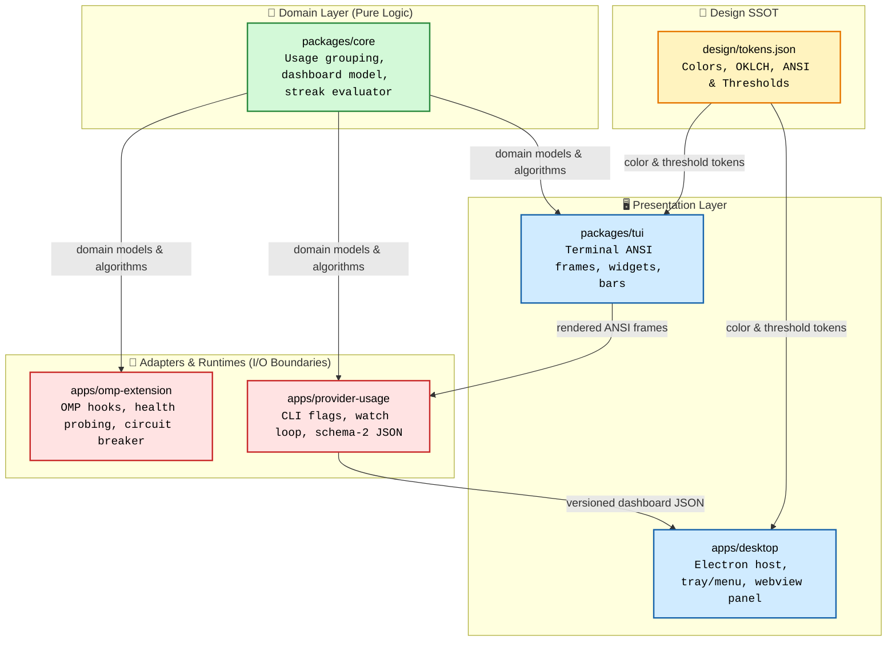
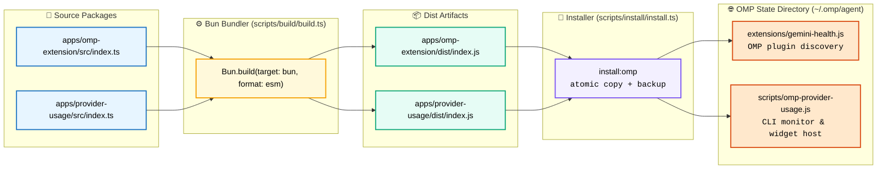
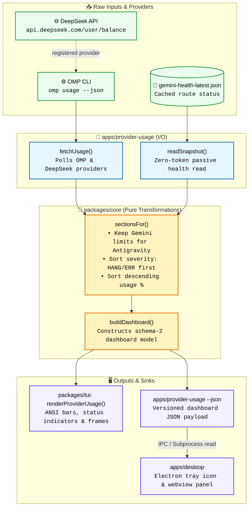
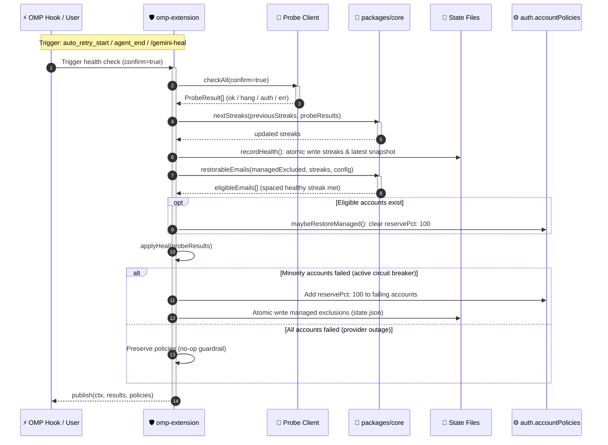
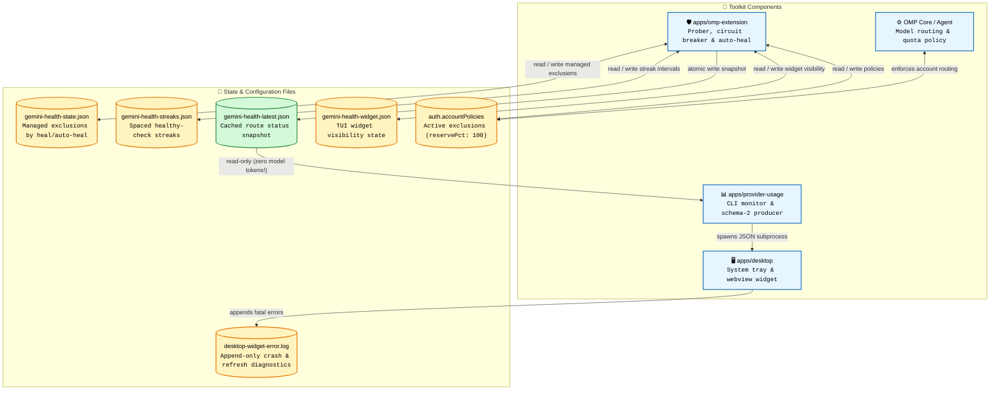

# Architecture

## Layers

| Layer                   | Package               | Responsibility                                                                                  |
| ----------------------- | --------------------- | ----------------------------------------------------------------------------------------------- |
| Domain                  | `packages/core`       | Pure usage grouping, column selection, route ordering, streak transitions, dashboard model      |
| Presentation (terminal) | `packages/tui`        | ANSI design tokens, semantic thresholds, bars, percentages, provider usage frame                |
| Presentation (desktop)  | `apps/desktop`        | Electron host, tray/menu, OS login item, terminal/Orca launch; renderer consumes dashboard JSON |
| Adapters                | `apps/omp-extension`  | OMP hooks, commands, tool, account probing, state/config persistence                            |
| Adapter                 | `apps/provider-usage` | CLI flags, `omp usage` read, snapshot read, watch loop, schema-2 JSON payload                   |
| Design                  | `design/tokens.json`  | Color and threshold SSOT for TUI ANSI and desktop OKLCH                                         |

`core` has no filesystem, process, network, or OMP imports. `tui` imports only
`core` and JSON tokens. The apps own I/O and runtime boundaries.

## Why the extension is one bundled app

OMP discovers extension modules from `~/.omp/agent/extensions/*.ts|js`. A
single-file bundle is the stable deployment unit. The source still follows the
same layering: the extension app imports shared domain logic and contains only
the OMP adapter, persistence, and probe transport.

`scripts/build/build.ts` bundles both apps with Bun:

`install:omp` renames them to `gemini-health.js` and
`omp-provider-usage.js` in the OMP state directory.

## Usage data flow

For Google Antigravity, `columnsFor` keeps only `Gemini` limits. Shared
Claude/GPT 3P limits are intentionally excluded from this focused view. Rows
are sorted by route severity first (`HANG`/`ERR`), then by highest selected
usage.

The OMP extension also registers a `deepseek` usage provider via
`pi.registerProvider("deepseek", { usage })`. `omp usage --json` polls
`https://api.deepseek.com/user/balance` using `DEEPSEEK_API_KEY` and returns a
`deepseek` report. The provider-usage CLI renders this report as currency
columns (`BALANCE`, `GRANTED`), preferring `CNY` over `USD`.
## Health data flow

The provider usage CLI only reads `gemini-health-latest.json`. It never probes
a model, so an idle monitoring tab spends zero model tokens. See
[roadmap.md](roadmap.md) for the 90-day reliability scaling plan,
[GLOSSARY.md](../GLOSSARY.md) for system terminology, and
[ADR-0002](adr/0002-opt-in-auto-restore.md) for opt-in recovery policy.

## State files

| File                         | Owner          | Purpose                                       |
| ---------------------------- | -------------- | --------------------------------------------- |
| `auth.accountPolicies`       | OMP config     | Active account exclusions (`reservePct: 100`) |
| `gemini-health-state.json`   | Extension      | Managed exclusions created by heal/auto-heal  |
| `gemini-health-streaks.json` | Extension      | Spaced healthy-check streaks                  |
| `gemini-health-latest.json`  | Extension      | Cached route snapshot for read-only UIs       |
| `gemini-health-widget.json`  | Extension      | TUI widget visibility                         |
| `desktop-widget-error.log`   | Desktop widget | Append-only fatal and refresh diagnostics     |

All non-config files use atomic writes. Mutating paths use strict reads so a
corrupt state file is surfaced rather than silently replaced. Streak corruption
is backed up to `.corrupt-<timestamp>` and rebuilt.

## Guardrails

- Heal applies only when a minority of accounts fail; all-failing is treated as
  provider-wide and changes nothing.
- Managed exclusions restore only after `restoreStreak` healthy checks, spaced
  by `restoreGapSeconds`.
- Manual exclusions are never auto-removed.
- `/gemini-enable` refuses when the latest snapshot is not `OK`, requires
  `--force` to override, and refuses ambiguous local-part matches.
- `publish` isolates UI failures from the check/heal path.
- Probe `401/403` invalidates the token cache.
- The usage monitor watch loop survives `omp usage` failures and keeps the last
  frame until the next successful read.
- The desktop widget never probes a model; it spawns the installed monitor CLI and renders its versioned JSON.
- The desktop renderer is local-only, sandboxed, with context isolation and CSP blocking all network access.

## Non-goals

- No automatic model fallback; the account circuit breaker preserves
  `gemini-3.8-flash`.
- No periodic health probing; the snapshot is refreshed by events/manual checks.
- No custom Orca status-bar item; Orca's public plugin API exposes right-sidebar
  panels and commands, not status-bar contributions.
- No packaged desktop binaries or auto-updater; the desktop widget runs from source via Bun.
- No Windows 11 Widgets-board provider; the widget uses the notification area / menu bar.
