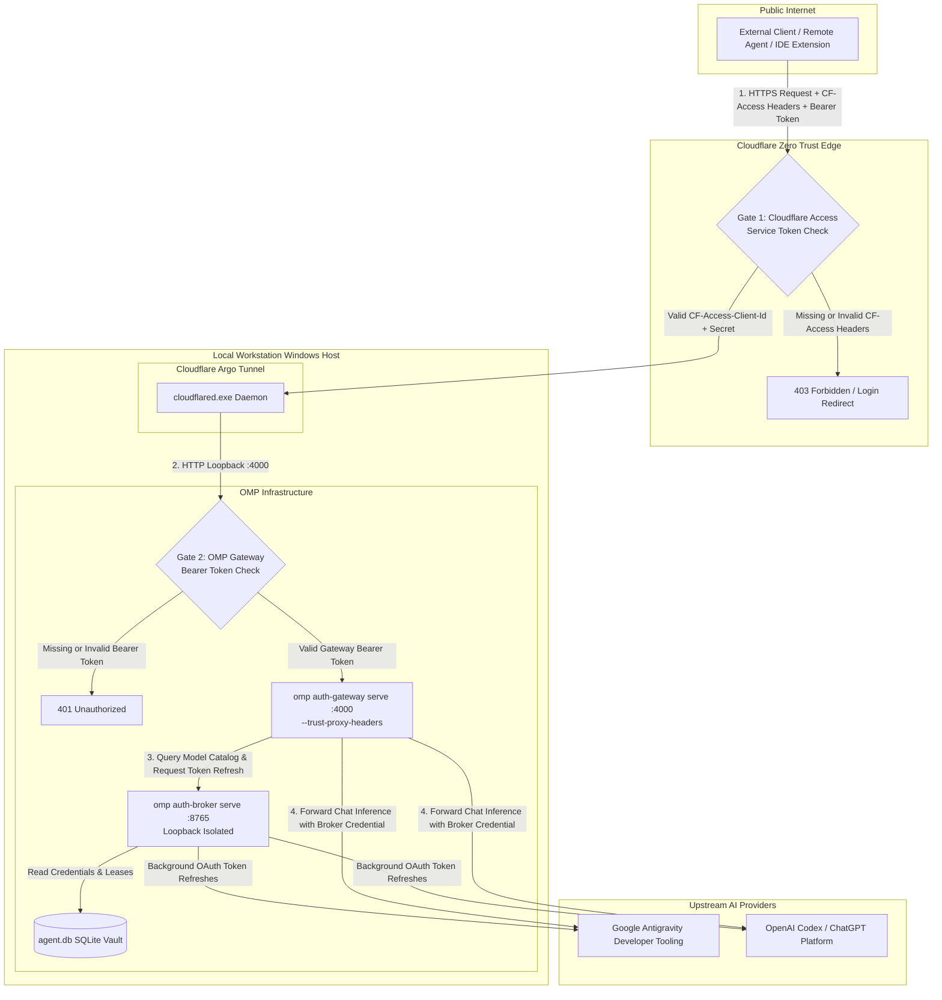
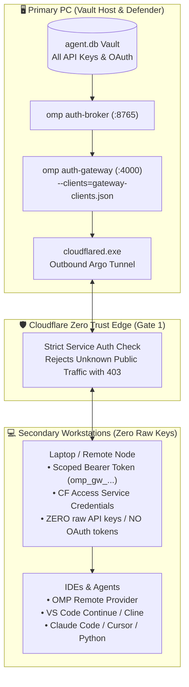

# OMP Auth Gateway + Cloudflare Tunnel & Zero Trust Access

> **Architecture Specification & Operator Runbook**  
> **Status:** Reference Implementation & Production Ready  
> **Target Environment:** Windows Workstation / Remote Development Nodes  

---

## 1. Executive Summary

The **OMP Auth Gateway** forward proxy (`omp auth-gateway serve`) enables external clients (IDEs, agent harnesses, remote coding agents, and scripts) to query AI models via standard OpenAI Chat Completions (`/v1/chat/completions`) and Anthropic Messages (`/v1/messages`) wire formats without directly exposing raw provider credentials.

To securely publish this gateway to the public internet while running on a local workstation, this architecture pairs the gateway with an encrypted **Cloudflare Argo Tunnel** and an automated **Two-Tier Defense-in-Depth** security model:

```
[Remote Client] 
      │  HTTPS :443 + (CF Service Token & Gateway Bearer)
      ▼
┌────────────────────────────────────────────────────────┐
│ Gate 1: Cloudflare Zero Trust (Edge Perimeter)         │
│ - Validates CF-Access-Client-Id & Secret               │
│ - Rejects unauthorized internet scanners with 403      │
└─────────────────────────┬──────────────────────────────┘
                          │ Encrypted QUIC/HTTP2 Tunnel
                          ▼
┌────────────────────────────────────────────────────────┐
│ Workstation Host (127.0.0.1)                           │
│ - cloudflared.exe routes traffic to local port 4000    │
│ - Gate 2: omp auth-gateway serve (:4000)               │
│   - Validates Authorization: Bearer <gateway-token>    │
│   - Translates wire format & maps model requests       │
│ - Backend: omp auth-broker serve (:8765, isolated)     │
│   - Holds canonical SQLite vault (agent.db)            │
│   - Handles background OAuth token refreshes           │
└────────────────────────────────────────────────────────┘
```

---

## 2. Two-Tier Defense-in-Depth Architecture



### The Authentication Gates:

| Gate | Verification Point | Required Headers | Failure Response |
| :--- | :--- | :--- | :--- |
| **Gate 1: Cloudflare Access** | Cloudflare Global Edge | `CF-Access-Client-Id`<br>`CF-Access-Client-Secret` | `HTTP 403 Forbidden` / OAuth Login Redirect |
| **Gate 2: OMP Auth Gateway** | Host Application (`:4000`) | `Authorization: Bearer <token>` | `HTTP 401 Unauthorized` |

---

## 3. Streaming Invariant (SSE Latency Optimization)

In standard reverse proxies, chunked HTTP responses are buffered until a buffer threshold is met. For LLM completions where tokens are emitted word-by-word via Server-Sent Events (SSE), proxy buffering causes high initial latency followed by sudden text dumps.

To preserve smooth token streaming across Cloudflare, the tunnel configuration (`config.yaml`) enforces:

```yaml
originRequest:
  noChunkedEncoding: false
  http2Origin: false
  connectTimeout: 30s
```

- `noChunkedEncoding: false`: Prevents Cloudflare from buffering chunks before forwarding.
- `http2Origin: false`: Avoids HTTP/2 framing race conditions over localhost loopback.
- `connectTimeout: 30s`: Prevents connection termination during long reasoning pre-fills.

---

## 4. Setup & Deployment Guide

### Step 1: Provision Cloudflare Tunnel
1. Authenticate `cloudflared`:
   ```bash
   cloudflared tunnel login
   ```
2. Create the tunnel:
   ```bash
   cloudflared tunnel create omp-gateway
   ```
3. Copy `templates/gateway/cloudflared-config.example.yaml` to `~/.cloudflared/config.yaml`:
   ```yaml
   tunnel: <YOUR_TUNNEL_UUID>
   credentials-file: ~/.cloudflared/<YOUR_TUNNEL_UUID>.json

   ingress:
     - hostname: gateway.example.com
       service: http://127.0.0.1:4000
       originRequest:
         noChunkedEncoding: false
         http2Origin: false
         connectTimeout: 30s
     - service: http_status:404
   ```

### Step 2: Configure Cloudflare Zero Trust (Service Token)
1. Open **Cloudflare Zero Trust Dashboard** > **Access** > **Service Auth** > **Service Tokens**.
2. Click **Create Service Token** (e.g. `omp-gateway-client`).
3. Save the generated **Client ID** and **Client Secret**.
4. Open **Access** > **Applications** > **Add an Application** > **Self-hosted**:
   - **Application Name:** `OMP Gateway`
   - **Application Domain:** `gateway.example.com`
   - **Policy:** Action = `Service Auth`, Rule = `Include > Service Token > omp-gateway-client`.

### Step 3: Configure Local Credentials
Copy `templates/gateway/cf-access.example.json` to `~/.omp/cf-access.json`:
```json
{
  "clientId": "<YOUR_CF_ACCESS_CLIENT_ID>",
  "clientSecret": "<YOUR_CF_ACCESS_CLIENT_SECRET>",
  "domain": "gateway.example.com"
}
```

### Step 4: Route DNS
In Cloudflare DNS, add a `CNAME` record:
- **Type:** `CNAME`
- **Name:** `gateway` (or chosen subdomain)
- **Target:** `<YOUR_TUNNEL_UUID>.cfargotunnel.com`
- **Proxy status:** `Proxied` (Orange cloud)

---

## 5. Operations & Lifecycle Management

Use the provided PowerShell script (`scripts/gateway/omp-gateway.ps1`) or Bun diagnostic tool (`scripts/gateway/doctor-gateway.ts`):

```powershell
# 1. Start Broker & Gateway as background daemons
powershell -File scripts/gateway/omp-gateway.ps1 start

# 2. Run comprehensive diagnostics (Health, Tunnel, Gate 1 & Gate 2)
bun run gateway:status

# 3. Execute live end-to-end chat completion tests
powershell -File scripts/gateway/omp-gateway.ps1 test

# 4. Display client configuration recipes
powershell -File scripts/gateway/omp-gateway.ps1 client-config

# 5. Stop all gateway services
powershell -File scripts/gateway/omp-gateway.ps1 stop
```

---

## 6. Client Integration Recipes

### A. cURL (Bash / Terminal)
```bash
curl -X POST https://gateway.example.com/v1/chat/completions \
  -H "CF-Access-Client-Id: <YOUR_CF_ACCESS_CLIENT_ID>" \
  -H "CF-Access-Client-Secret: <YOUR_CF_ACCESS_CLIENT_SECRET>" \
  -H "Authorization: Bearer <YOUR_OMP_GATEWAY_TOKEN>" \
  -H "Content-Type: application/json" \
  -d '{
    "model": "google-antigravity/gemini-3.8-flash",
    "messages": [{"role": "user", "content": "Hello via OMP Gateway"}],
    "stream": true
  }'
```

### B. Python (OpenAI SDK)
```python
from openai import OpenAI

client = OpenAI(
    base_url="https://gateway.example.com/v1",
    api_key="<YOUR_OMP_GATEWAY_TOKEN>",
    default_headers={
        "CF-Access-Client-Id": "<YOUR_CF_ACCESS_CLIENT_ID>",
        "CF-Access-Client-Secret": "<YOUR_CF_ACCESS_CLIENT_SECRET>",
    },
)

response = client.chat.completions.create(
    model="google-antigravity/gemini-3.8-flash",
    messages=[{"role": "user", "content": "Hello!"}],
    stream=True,
)
for chunk in response:
    print(chunk.choices[0].delta.content or "", end="", flush=True)
```

### C. Python (Anthropic SDK)
```python
import anthropic

client = anthropic.Anthropic(
    base_url="https://gateway.example.com",
    api_key="<YOUR_OMP_GATEWAY_TOKEN>",
    default_headers={
        "CF-Access-Client-Id": "<YOUR_CF_ACCESS_CLIENT_ID>",
        "CF-Access-Client-Secret": "<YOUR_CF_ACCESS_CLIENT_SECRET>",
    },
)

message = client.messages.create(
    model="google-antigravity/gemini-3.8-flash",
    max_tokens=1000,
    messages=[{"role": "user", "content": "Hello!"}],
)
print(message.content[0].text)
```

### D. VS Code Extensions (Continue / Cline `config.json`)
```json
{
  "models": [
    {
      "title": "Gemini 3.8 Flash (OMP Gateway)",
      "provider": "openai",
      "model": "google-antigravity/gemini-3.8-flash",
      "apiBase": "https://gateway.example.com/v1",
      "apiKey": "<YOUR_OMP_GATEWAY_TOKEN>",
      "requestOptions": {
        "extraHeaders": {
          "CF-Access-Client-Id": "<YOUR_CF_ACCESS_CLIENT_ID>",
          "CF-Access-Client-Secret": "<YOUR_CF_ACCESS_CLIENT_SECRET>"
        }
      }
    }
  ]
}
```

---

## 7. Troubleshooting & Diagnostics

| Symptom / Error | Root Cause | Remediation |
| :--- | :--- | :--- |
| **HTTP 530 (Error 1016 Origin DNS)** | Hostname has no CNAME in Cloudflare DNS pointing to tunnel | Add CNAME `<subdomain>` -> `<TUNNEL_UUID>.cfargotunnel.com` (Proxied). |
| **HTTP 403 Forbidden** | Request blocked by Gate 1 (Cloudflare Access) | Verify `CF-Access-Client-Id` and `CF-Access-Client-Secret` headers are present and match active Service Token. |
| **HTTP 401 Unauthorized** | Request blocked by Gate 2 (OMP Gateway) | Verify `Authorization: Bearer <token>` header matches `~/.omp/auth-gateway.token`. |
| **Stream Latency / Bursting** | Chunk buffering enabled on proxy | Ensure `noChunkedEncoding: false` is set in `~/.cloudflared/config.yaml`. |
| **Broker Connection Refused** | Auth Broker daemon not started | Run `powershell -File scripts/gateway/omp-gateway.ps1 start` to start broker on port 8765. |

---

## 8. Multi-PC Zero-Leak Deployment & Defender Guide

### Why This Architecture Protects Your Credentials
Exporting and importing OMP state or raw API keys (`agent.db`, Google OAuth tokens, DeepSeek keys) across multiple workstations (e.g. secondary laptops, remote VMs, travel PCs) creates critical attack surfaces:
1. **Key Leakage Risk:** Credentials stored on portable laptops can be exposed via git commits, unencrypted disks, or compromised local environments.
2. **OAuth Invalidation:** Many OAuth providers (such as Google Antigravity) enforce rotating refresh tokens. When multiple machines refresh using the same credentials, one machine inevitably invalidates the session for all others.

With the **Two-Tier Defender Architecture**, the primary workstation acts as the single air-gapped vault. Secondary PCs only receive scoped bearer tokens and Cloudflare Access service credentials:



### Step-by-Step Operator Workflow

#### 1. On the Primary PC (Vault Host)
Start the gateway daemons (if not already running):
```powershell
powershell -ExecutionPolicy Bypass -File scripts/gateway/omp-gateway.ps1 start
```
Or from inside an active OMP terminal session:
```
/gateway start
```

#### 2. Issue a Scoped Token for a Secondary PC
To onboard a new machine (e.g. `laptop-air`), run:
```powershell
powershell -ExecutionPolicy Bypass -File scripts/gateway/omp-gateway.ps1 client-add laptop-air -Models "google-antigravity/*,deepseek/*"
```
Or inside OMP:
```
/gateway client-add laptop-air
```
This generates a unique bearer token (`omp_gw_...`), writes its SHA-256 hash to `~/.omp/gateway-clients.json` (auto-reloaded without server restart), and displays the **Client Setup Pack**.

#### 3. On the Secondary PC (Client)
Configure the client environment using the generated setup script:

**macOS / Linux:**
```bash
export OPENAI_BASE_URL="https://gateway.example.com/v1"
export OPENAI_API_KEY="omp_gw_<token>"
export CF_ACCESS_CLIENT_ID="<client-id>.access"
export CF_ACCESS_CLIENT_SECRET="<client-secret>"
```

**Windows (PowerShell):**
```powershell
$env:OPENAI_BASE_URL = "https://gateway.example.com/v1"
$env:OPENAI_API_KEY = "omp_gw_<token>"
$env:CF_ACCESS_CLIENT_ID = "<client-id>.access"
$env:CF_ACCESS_CLIENT_SECRET = "<client-secret>"
```

Now run any coding agent, IDE extension, or Python script on the secondary PC. All inference routes through your primary workstation's accounts while your raw credentials remain 100% isolated.

#### 4. Emergency Revocation
If a secondary PC is lost, decommissioned, or compromised, immediately revoke its access from the primary PC without restarting services or affecting other machines:
```powershell
powershell -ExecutionPolicy Bypass -File scripts/gateway/omp-gateway.ps1 client-revoke laptop-air
```
The gateway re-reads `gateway-clients.json` instantaneously, and all subsequent requests from that token are rejected with `HTTP 401 Unauthorized`.
