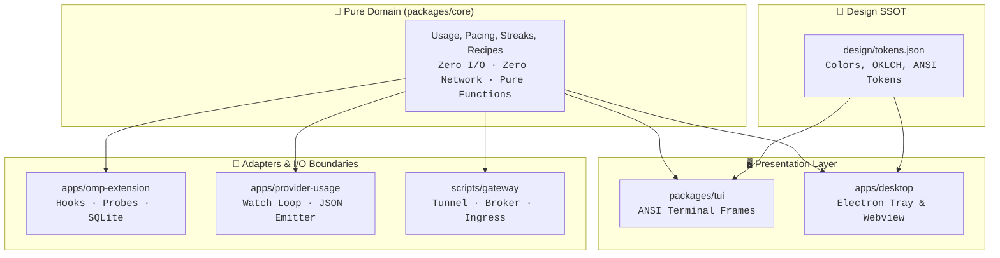
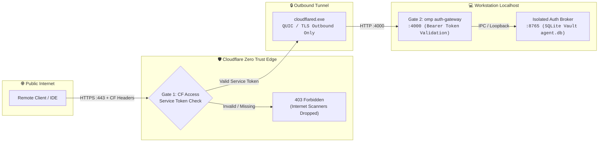
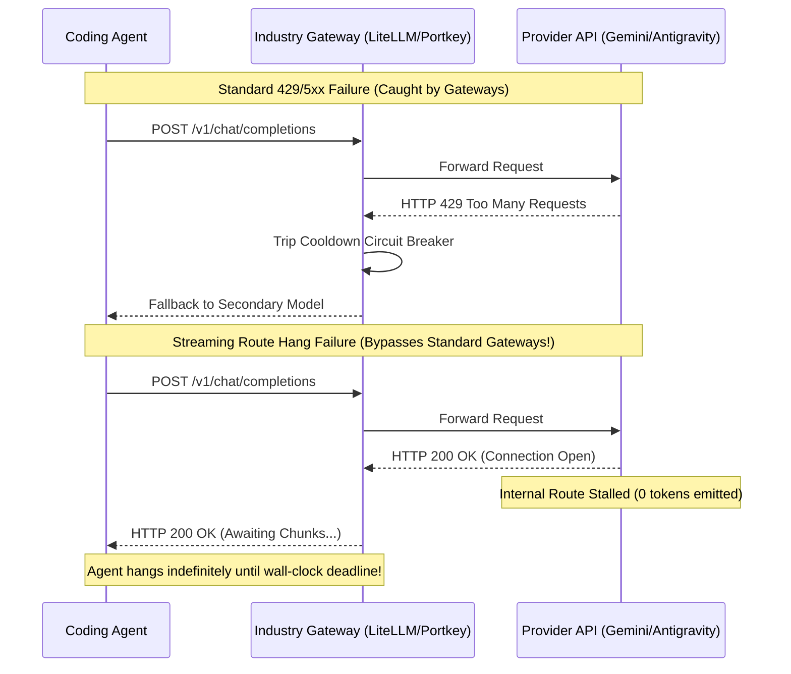
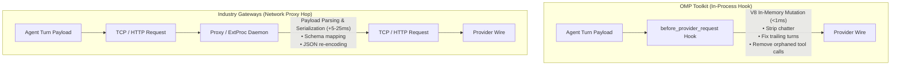

# Research Report: Architectural Comparison — OMP Toolkit vs. Industry AI Gateways

> **Date:** 2026-11-02  
> **Target:** System Architecture, Edge Ingress, Resilience, Quota Pacing, and Data Sovereignty  
> **Evaluated Architectures:** OMP Toolkit, LiteLLM Proxy & Router, Portkey AI Gateway, Cloudflare AI Gateway, and Envoy AI Gateway / Agent Router  
> **Evaluation Mode:** Primary-source architectural analysis, protocol inspection, and comparative systems review  

---

## 1. Executive Summary & Architectural Matrix

As generative AI adoption transitions from experimental scripts to mission-critical developer workflows, the software architecture governing model access, reliability, and security has split into two competing paradigms:

1. **Centralized Multi-Tenant Enterprise Gateways:** Systems designed to run as shared infrastructure inside Kubernetes clusters, enterprise VPCs, or global edge CDNs (e.g., LiteLLM, Portkey, Cloudflare AI Gateway, Envoy AI Gateway). These prioritize team billing, RBAC, multi-region failover, and compliance audit logging.
2. **Local-First Developer Agent Toolkits:** Systems designed for high-leverage developer workstations and autonomous coding agents (e.g., OMP Toolkit). These prioritize pure domain isolation, sub-millisecond execution, zero-token overhead, local data sovereignty, and specialized resilience against provider-specific degradation (such as streaming route hangs).

With the recent introduction of the **OMP Auth Gateway + Cloudflare Tunnel & Zero Trust Access** integration (`docs/auth-gateway-cloudflare.md`), OMP Toolkit establishes a hybrid bridge: maintaining local-first execution, pure domain logic, and local credential isolation while providing edge-authenticated, Zero Trust ingress for external clients (IDEs, remote coding agents, and CI pipelines).

### Comparative Architecture Matrix

| Architectural Axis | OMP Toolkit (`omp-toolkit`) | LiteLLM Proxy (`litellm`) [1, 2] | Portkey AI Gateway (`portkey`) [3, 4] | Cloudflare AI Gateway (`cf-aig`) [5, 6] | Envoy AI Gateway / Agent Router [7, 8] |
| :--- | :--- | :--- | :--- | :--- | :--- |
| **Primary Deployment** | Workstation-local (Windows/macOS/Linux) + Cloudflare Argo Tunnel | Self-hosted Docker container, VM, or Kubernetes pod | Self-hosted Node/Bun, Cloudflare Workers, or Managed SaaS | Multi-tenant Global Edge Anycast Network (Workers) | Kubernetes-native (Envoy Proxy + Gateway API CRDs) |
| **Layering & Domain Isolation** | **Strict Unidirectional:** Pure domain (`packages/core`, 0 I/O) separated from adapters and UI | **Monolithic Proxy:** Python/FastAPI coupling HTTP I/O, routing, and DB logic | **Modular TS Proxy:** TypeScript middleware pipeline running on Node/Bun/Workers | **Serverless Edge:** Distributed Cloudflare Workers runtime on V8 isolates | **Control/Data Separation:** C++ Envoy proxy with gRPC External Processor (`ExtProc`) |
| **Edge Ingress & Perimeter Defense** | **Two-Tier Defense:** Gate 1 CF Access Service Token (strict 403) $\rightarrow$ Gate 2 Local Bearer + Isolated Broker | API Key / Virtual Key checked at proxy; relies on external reverse proxy (Nginx/Traefik) for edge | Virtual Key checked in proxy; optional VPC perimeter or Cloudflare Workers deployment | Cloudflare Edge WAF, DLP, PII redaction, and Access rules | Kubernetes Ingress / GatewayClass security policies + mTLS |
| **Credential Storage & Isolation** | **Air-Gapped Local Broker:** Port 8765 SQLite vault (`agent.db`); forward proxy never stores master keys | In-Memory, PostgreSQL database, or Redis key store | Encrypted database vault or Portkey Cloud control plane | Cloudflare encrypted secret store (dashboard/API) | Kubernetes Secrets mounted to Envoy pods or secret providers |
| **Streaming Route Hang Detection** | **Active Stream Classifier:** Detects infinite stalls; trips two-strike circuit breaker via `reservePct: 100` | **Passive HTTP Codes:** Tripped by HTTP 429/5xx or timeout; cannot classify stalled streams | **Passive HTTP Codes:** Tripped by status codes (429, 500, 502) and static request timeouts | **HTTP Timeouts:** Cascades to fallback model upon HTTP timeout or upstream error | **Stream Timeouts:** Intercepted by ExtProc or Envoy stream idle timeouts |
| **Circuit Breaking & Recovery** | **Event-Driven & Streak-Based:** Spaced healthy probes auto-restore; zero idle token burn | **Cooldowns:** Temporary duration cooldown per deployment; retries within group | **Fallback Cascades:** Immediate step-down through secondary/tertiary model chain | **Fallback Trees:** Immediate reroute to secondary model defined in dashboard | **Inference Pool Failover:** Reroutes traffic to healthy backend deployment |
| **Quota & Pacing Engine** | **Rolling Weekly Pacing:** Pacing fractions, headroom tracking, reset timetable alignment | **Sliding Window:** Leaky-bucket RPM/TPM rate limits and team dollar spend caps | **Static Limits:** RPM/TPM limits and credit-based budgets per virtual key | **Fixed/Sliding Windows:** Request-count limits and monthly dollar spend caps | **Token-Aware Rate Limiting:** Token bucket integrated with Redis rate limit service |
| **Wire Protocol Normalization** | **In-Process V8 Hooks:** Rewrites turns, removes chatter, strips malformed calls ($< 1\text{ ms}$) | **Cross-Provider Translation:** Normalizes 100+ provider formats to OpenAI/Anthropic wire | **Cross-Provider Translation:** Uniform OpenAI signature mapped to 1,600+ models | **Universal Endpoint:** Translates OpenAI requests to Bedrock, Vertex, Anthropic | **ExtProc Translation:** Transforms payload schemas across providers via gRPC filter |
| **Observability & Sovereignty** | **100% Local & Zero Telemetry:** Local SQLite history DB, ANSI TUI, desktop tray widget | Local logging or external export to Langfuse, OpenTelemetry, Datadog | Local traces or export to Portkey Cloud, Langfuse, or Datadog | Cloudflare dashboard analytics, logpush to S3/R2, token metrics | Prometheus metrics, OpenTelemetry traces, Envoy access logs |

---

## 2. Layering & Architectural Seams Analysis

### OMP Toolkit's Pure Domain Model
The foundational invariant of OMP Toolkit is **strict unidirectional dependency flow with zero I/O leakage into domain logic** (`docs/architecture.md:4-16`):
- **`packages/core` (Pure Domain):** Contains usage calculation, route ordering, streak transitions, rolling weekly pacing models, and client recipe generation. It has **zero** filesystem imports, **zero** network imports, **zero** process calls, and **zero** ANSI escape codes.
- **`packages/tui` (Terminal Presentation):** Consumes `core` domain models and binds strictly to `design/tokens.json` to produce formatted ANSI strings.
- **`apps/desktop` (Desktop Presentation):** Context-isolated Electron tray widget consuming serialized domain models, styled exclusively via OKLCH design tokens.
- **`apps/omp-extension` & `apps/provider-usage` (Adapters):** Handle all side effects, OMP runtime hooks, OAuth token refreshes, SQLite persistence, and network transport.



### Contrast with Industry Implementations
1. **LiteLLM Proxy (Python/FastAPI):** LiteLLM implements an all-in-one server architecture. While convenient for rapid deployment, its codebase tightly couples HTTP routing (`proxy_server.py`), database ORM queries (Prisma/SQLAlchemy), caching (Redis), and provider payload translation into single execution contexts. Testing routing algorithms requires mocking network layers or spinning up test containers.
2. **Envoy AI Gateway (C++ & Kubernetes CRDs):** Envoy decouples via the classic **Control Plane vs. Data Plane** separation [7]. The control plane watches Kubernetes Custom Resources (`AIGatewayRoute`, `AIServiceBackend`) and compiles them into xDS protocol streams. The data plane processes requests in C++, offloading payload inspection to an External Processor (`ExtProc`) over gRPC. While this architecture scales to tens of thousands of requests per second across Kubernetes clusters, its architectural weight, memory footprint, and deployment prerequisites make it unusable on a local developer workstation.
3. **Portkey AI Gateway (TypeScript/Bun):** Portkey adopts a modular middleware pipeline pattern [4]. Like OMP Toolkit, it leverages modern TypeScript and Bun runtimes. However, Portkey is architected primarily as a stateless proxy; persistent rate-limiting and virtual key management require an external Redis cluster or Portkey Cloud synchronization.

---

## 3. Edge Ingress & Zero Trust Defense Comparison

A major architectural challenge for local AI agent harnesses is allowing external devices (mobile IDEs, remote servers, secondary laptops) to leverage workstation AI credentials without exposing the host to the public internet.



### OMP Toolkit's Two-Tier Defense Model
As formalized in `docs/auth-gateway-cloudflare.md`, OMP Toolkit pairs a local forward proxy with Cloudflare Zero Trust:
- **Zero Inbound Attack Surface:** No inbound ports (e.g. 80, 443, 4000) are opened on the workstation firewall or router. `cloudflared` initiates outbound-only encrypted QUIC/TLS tunnels to Cloudflare edge nodes.
- **Gate 1 (Perimeter Defense):** Cloudflare Access enforces **Strict Service Token Authentication** at the edge. Internet scanners, port probes, and automated bots without `CF-Access-Client-Id` and `CF-Access-Client-Secret` are dropped immediately with an HTTP 403 before reaching the tunnel.
- **Gate 2 (Local Authorization):** Requests reaching the workstation must present a valid `Authorization: Bearer <gateway-token>`.
- **Vault Isolation (Auth Broker):** The gateway (`:4000`) does not hold raw API credentials or OAuth refresh tokens. Instead, it delegates inference token assembly to the isolated `omp auth-broker` daemon (`:8765`), which exclusively manages the encrypted SQLite vault (`agent.db`).

### Streaming SSE Integrity Invariant
A subtle failure mode in reverse-proxying LLM traffic is stream buffering. Standard edge proxies buffer incoming HTTP chunks to perform compression or inspection, converting real-time token-by-token streaming into a delayed, blocky burst.
OMP Toolkit resolves this by establishing explicit configuration invariants in `templates/gateway/cloudflared-config.example.yaml`:
```yaml
originRequest:
  noChunkedEncoding: false
  http2Origin: false
  connectTimeout: 30s
```
- `noChunkedEncoding: false`: Mandates that Cloudflare edge does not buffer Server-Sent Events (SSE), ensuring instantaneous token delivery to coding agent clients.
- `http2Origin: false`: Avoids multiplexing stream stalls over HTTP/2 loopback connections on Windows workstations.

### Industry Comparison
- **Cloudflare AI Gateway:** Operates entirely within Cloudflare's infrastructure [5]. While edge latency is minimal, API keys must be uploaded to Cloudflare's servers. For developers using OAuth subscriptions (e.g. Google Antigravity, OpenAI Codex subscription tokens), Cloudflare AI Gateway cannot manage local desktop OAuth sessions.
- **LiteLLM / Portkey:** Typically secured by placing an Nginx, Traefik, or Caddy reverse proxy in front of the container, or by exposing the service over a Tailscale / WireGuard mesh network. Tailscale requires client installation on every accessing node; OMP's Cloudflare Access approach enables any standard HTTP client (such as Python `requests`, `curl`, or VS Code `continue`) to connect via standard HTTPS headers without client-side VPN software.

---

## 4. Resilience, Route Probing & Circuit Breaking

The most distinct divergence between OMP Toolkit and industry gateways lies in **failure classification**.

### The Streaming Route Hang Problem
Standard API gateways (LiteLLM, Portkey, Cloudflare AI Gateway, Envoy) classify failures based on **HTTP status codes**:
- `429 Too Many Requests` $\rightarrow$ Rate limited.
- `500 Internal Server Error`, `502 Bad Gateway`, `503 Service Unavailable` $\rightarrow$ Server failure.
- TCP Connection Refused or Connect Timeout $\rightarrow$ Network down.

However, complex AI providers (notably Google Antigravity `gemini-3.8-flash`) exhibit a different failure mode: **Streaming Route Hangs**. In a streaming hang:
1. The HTTP handshake succeeds with `200 OK`.
2. The initial response headers are sent.
3. The model generation stalls indefinitely without emitting chunks, or halts mid-generation without sending a closing chunk or error frame.
4. No HTTP error code is ever returned.



### OMP Toolkit's Route Classifier & Event-Driven Health
To eliminate stream hangs, `@omp-toolkit/omp-extension` implements active client-side classification:
1. **Lightweight Active Probing:** Issues minimal streaming requests directly to provider endpoints using OMP OAuth tokens.
2. **State Categorization:** Classifies routes into exact states: `OK`, `HANG` (stalled token stream), `ERR` (HTTP failure), `AUTH` (invalid OAuth token), or `MODEL` (quota/access error).
3. **Two-Strike Escalation:** An account is not excluded on a single transient glitch. Two consecutive failing probes trip the circuit breaker.
4. **Targeted Policy Exclusion:** Rather than dropping all traffic, OMP Toolkit sets `reservePct: 100` specifically for the failing account inside OMP's `auth.accountPolicies`, diverting agent turns to healthy peer accounts.
5. **Streak-Based Auto-Restore:** Excluded accounts enter a recovery observation state. Upon logging consecutive healthy checks spaced over time, the account is automatically restored to the active routing pool (`docs/adr/0002-opt-in-auto-restore.md`).
6. **Zero-Idle-Token Invariant:** Unlike enterprise gateways that poll health endpoints on a continuous 10-second cron (wasting API tokens and rate-limit quotas), OMP Toolkit probes **only on events**: session startup, tool execution, manual commands, or error-triggered hooks (`docs/adr/0001-event-driven-health.md`).

---

## 5. Quota Scheduling, Weekly Pacing & Resource Optimization

Enterprise gateways manage capacity via **rate limits** and **dollar budgets**:
- **LiteLLM:** Enforces Requests Per Minute (RPM) and Tokens Per Minute (TPM) using Redis-backed leaky-bucket counters [1, 2].
- **Cloudflare AI Gateway:** Tracks request counts in sliding windows and blocks calls when cumulative dollar spend exceeds monthly limits [5, 6].
- **Envoy AI Gateway:** Uses token-bucket algorithms implemented in Envoy's Rate Limit Service [7].

### OMP Toolkit's Rolling Weekly Pacing
For software developers using subscription-based AI services (such as Muse Code or fixed-tier developer plans), traditional RPM/TPM and dollar budgets do not prevent mid-week quota exhaustion. Subscriptions grant fixed token allocations that reset on specific days of the week or rolling 7-day intervals.

OMP Toolkit's pure domain pacing engine (`packages/core/src/pacing.ts`) models consumption across time windows:
$$\text{Day Index } d \in [0, 6], \quad \text{Ceiling Fraction } = \frac{d + 1}{7}$$
$$\text{Headroom Fraction } = \text{Ceiling Fraction} - \text{Current Consumption Fraction}$$

- **Pacing Marker:** Presentation layers render a dynamic pacing target marker ($\triangledown$) alongside the usage bar. If the current consumption bar exceeds the ceiling marker, the operator immediately recognizes that usage velocity will exhaust quota before the reset date.
- **30-Day Retention Pruning:** The pacing store maintains deterministic 30-day historical samples, automatically pruning expired data without unbounded database growth.
- **Timetable Scheduling:** Aligns agent workload intensity with provider reset schedules (`docs/adr/0007-multi-provider-time-window-scheduling.md`), guaranteeing maximum throughput without hitting end-of-cycle lockouts.

---

## 6. Wire Protocol Normalization & In-Flight Sanitization

When autonomous coding agents execute multi-step plans across disparate models, context corruption often causes catastrophic failure:
- Trailing assistant messages without closing user turns.
- Malformed tool calls or empty argument JSON.
- Provider-specific thinking artifacts (e.g., Gemini `<thought>` tokens or internal commentary leaking into tool execution).



### In-Process vs. Proxy-Hop Transformation
- **Industry Gateways (LiteLLM / Envoy ExtProc / Portkey):** All requests must be serialized into JSON, transmitted over a network socket (or gRPC IPC channel in Envoy), parsed into internal data structures, modified, re-serialized, and sent upstream. This introduces serialization overhead, network latency ($5\text{--}25\text{ ms}$), and potential connection drops.
- **OMP Toolkit (`apps/omp-extension`):** Utilizes the OMP runtime's in-process `before_provider_request` lifecycle hook. Normalization operates directly on in-memory V8 JavaScript objects before wire serialization. Modifications execute in sub-millisecond time ($< 0.2\text{ ms}$), with zero network hops, zero socket allocation, and zero risk of proxy process crash mid-turn.

---

## 7. Strategic Recommendations & Roadmap Alignment

Based on this comparative analysis, OMP Toolkit maintains distinct architectural advantages in **domain isolation, streaming resilience, zero-token efficiency, and developer privacy**. To further harden the architecture, the following high-ROI patterns from industry gateways should be considered for future roadmap cycles:

### 1. Cryptographic Origin JWT Verification (`Cf-Access-Jwt-Assertion`)
- **Current State:** OMP Auth Gateway validates Bearer tokens at Gate 2 and relies on Cloudflare Tunnel configuration to ensure Gate 1 was traversed.
- **Industry Best Practice:** Cloudflare Access injects a signed JWT header (`Cf-Access-Jwt-Assertion`) upon validating Service Tokens [7].
- **Recommendation:** Implement an optional origin validation check in `scripts/gateway/doctor-gateway.ts` and the gateway adapter to fetch Cloudflare's public JWKS (`https://<team>.cloudflareaccess.com/cdn-cgi/access/certs`) and verify the JWT signature locally, providing true cryptographic defense-in-depth against internal network spoofing.

### 2. Standardized Client Recipe Generation
- **Current State:** Prototype recipe generator added in `packages/core/src/gateway/recipes.ts` supporting `curl`, `python-openai`, `python-anthropic`, and `vscode-continue`.
- **Industry Best Practice:** Portkey and LiteLLM provide extensive copy-paste SDK snippets for LangChain, LlamaIndex, LiteLLM client, and OpenWebUI.
- **Recommendation:** Expand `ClientRecipePlatform` in `@omp-toolkit/core` to include automated configuration snippets for `aider`, `cline`, and `open-webui`, establishing OMP Auth Gateway as the universal local backend for all developer tools.

### 3. Preserving Core Architectural Invariants
- **Maintain Zero-I/O Purity:** Never allow filesystem, network, or process calls to penetrate `packages/core`. All gateway, doctor, and tunnel logic must remain cleanly decoupled in `scripts/gateway/` or adapter packages.
- **Uphold Zero-Idle-Token Rule:** Resist adding continuous background polling loops. Health probes must strictly remain event-driven to preserve operator API quotas.

---

## Sources & Primary Citations

1. **LiteLLM Architecture & Router:**  
   https://docs.litellm.ai/docs/proxy/architecture  
   https://docs.litellm.ai/docs/routing  
   *Primary documentation for LiteLLM Model Groups, cooldown circuit-breaking, and Redis-backed state replication.*

2. **LiteLLM Load Balancing & Reliability:**  
   https://docs.litellm.ai/docs/proxy/load_balancing  
   https://docs.litellm.ai/docs/proxy/reliability  
   *Details on rate-limit-aware routing, intra-group retries, and cross-provider fallback chains.*

3. **Portkey AI Gateway Architecture:**  
   https://github.com/portkey-ai/gateway  
   https://portkey.ai/blog/retries-fallbacks-and-circuit-breakers-in-llm-apps/  
   *Open-source repository, TypeScript modular architecture, status-code triggers, and virtual key security.*

4. **Portkey Gateway Deployments & Middleware:**  
   https://github.com/Portkey-AI/gateway/blob/main/docs/installation-deployments.md  
   *Documentation of Node.js/Bun runtimes, Cloudflare Workers deployments, and enterprise VPC isolation.*

5. **Cloudflare AI Gateway Features & Architecture:**  
   https://developers.cloudflare.com/ai-gateway/  
   https://developers.cloudflare.com/ai-gateway/features/  
   *Control plane reverse proxy architecture, Auto Router, dynamic routing, and multi-model fallbacks.*

6. **Cloudflare AI Gateway Caching & Rate Limiting:**  
   https://developers.cloudflare.com/ai-gateway/features/caching/  
   https://developers.cloudflare.com/ai-gateway/features/rate-limiting/  
   *SHA-256 edge caching (`cf-aig-cache-status`), sliding window rate limits, and spend budgets.*

7. **Envoy AI Gateway / Agent Router System Architecture:**  
   https://aigateway.envoyproxy.io/docs/0.7/concepts/architecture/system-architecture/  
   https://github.com/theagentrouter/agent-router  
   *Linux Foundation / CNCF architecture: Envoy Proxy C++ data plane, Kubernetes Gateway API CRDs, ExtProc filters.*

8. **Cloudflare Zero Trust Access & Service Tokens:**  
   https://developers.cloudflare.com/cloudflare-one/access-controls/service-credentials/service-tokens/  
   *Machine-to-machine Zero Trust access policies, strict service token authentication, and origin JWT assertion.*
