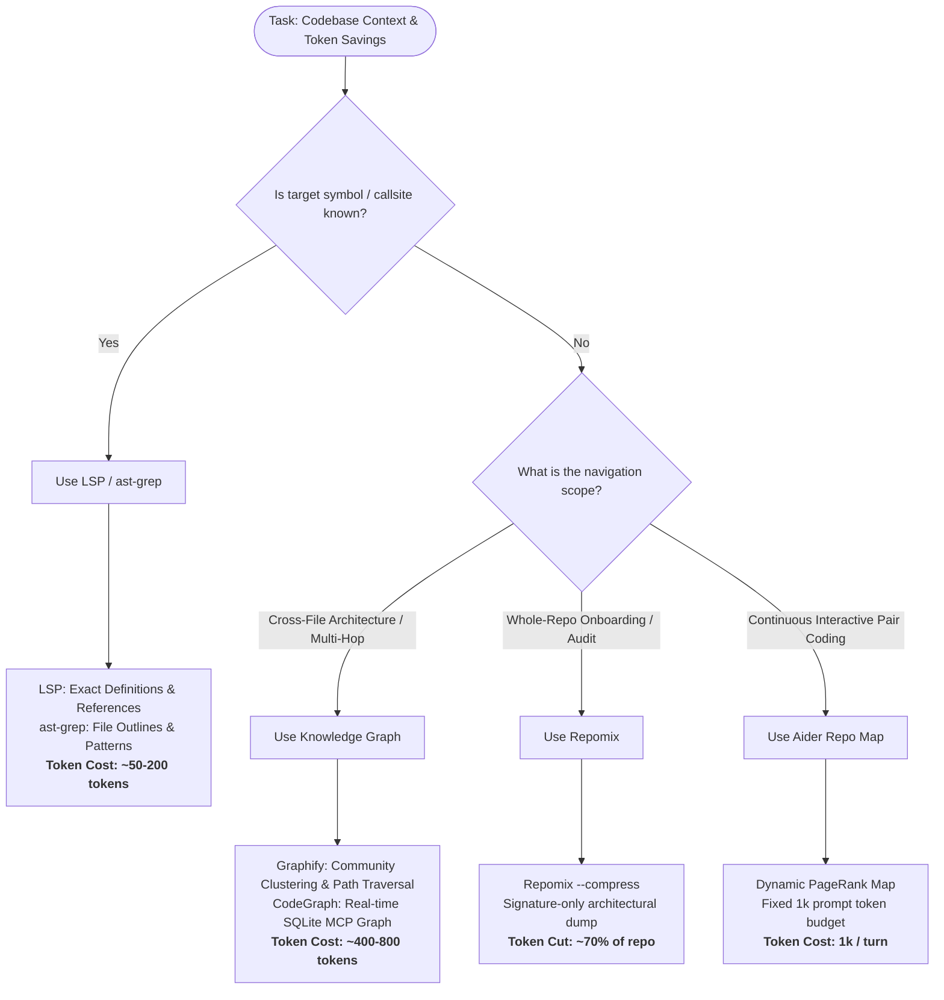

# Comparative Research: Graphify Alternatives for Code Context & Token Optimization

**Date:** 2026-10-28  
**Subject:** In-depth evaluation of alternatives to [Graphify-Labs/graphify](https://github.com/Graphify-Labs/graphify) for codebase context management, token optimization, and agent code intelligence.

---

## 1. Executive Summary & Verdict

Managing codebase context for AI coding agents involves resolving the **Navigation Paradox**: packing entire source files into an LLM's context window degrades model attention (the "lost-in-the-middle" phenomenon) and burns millions of tokens, while blind lexical grep often misses multi-file architectural dependencies.

Tooling in this space falls into **five distinct architectural categories**:
1. **Granular Knowledge Graphs (Graphify, CodeGraph):** Parse source trees into persistent, entity-level relational graphs with multi-hop traversals and community clustering.
2. **Structural PageRank Repo Maps (Aider Repo Map):** Build identifier reference graphs and project dynamic, token-budgeted outlines directly into prompt turns.
3. **On-Demand AST Outlining (ast-grep `outline`):** Execute zero-storage, instantaneous syntax parsing to retrieve symbol signatures on-demand.
4. **Macro Repository Packers (Repomix / Repopack):** Compress entire codebases into structured XML/Markdown by stripping function bodies via Tree-sitter (~70% token cut).
5. **Compiler-Grade Semantic Intelligence (LSP / SCIP):** Leverage native language server protocols (e.g. `typescript-language-server`, `pyright`, `rust-analyzer`) for 100% deterministic, zero-hallucination symbol definitions and call references.

### The Verdict: What is the "Best Fit"?

There is no single universal tool; the optimal choice depends strictly on the engineering task archetype:

- **For Large Monorepo Navigation & Deep Impact Analysis (e.g., `@omp-toolkit`):**  
  **Winner: LSP (`xd://lsp`) + `ast-grep outline`**  
  *Why:* Zero external database overhead, zero background daemons, 100% deterministic precision on symbol callsites/references, and instant file outline trimming (~100 tokens per file).
- **For Automated Root Cause Analysis & Multi-Hop Path Tracing:**  
  **Winner: Graphify or CodeGraph MCP**  
  *Why:* Graph traversal primitives (`graphify path A B`) resolve multi-hop dependencies spanning 5+ files that lexical grep and file-level repo maps cannot connect.
- **For Interactive Terminal AI Pair Programming:**  
  **Winner: Aider Repo Map**  
  *Why:* Battle-tested in Aider CLI; seamlessly maintains a tight 1,024-token architectural map inside the agent's prompt without manual tool invocations.
- **For Initial Project Bootstrapping & Whole-Repo Audits:**  
  **Winner: Repomix (`--compress`)**  
  *Why:* One-shot command packaging the entire codebase into an AI-friendly, signature-only prompt block for initial architectural reviews.

---

## 2. Detailed Alternative Profiles

### A. Graphify (Baseline Reference)
- **Architecture:** Python CLI / skills. Parses source files using Tree-sitter AST, constructs in-memory / SQLite / JSON graphs, and applies the Leiden algorithm for community detection.
- **Interaction Model:** Agent runs CLI commands (`graphify explain <symbol>`, `graphify path <start> <end>`, `graphify query "<question>"`) returning subgraphs.
- **Strengths:**
  - $0 LLM ingest cost for code (pure Tree-sitter AST).
  - Explicit edge typing (`EXTRACTED` vs `INFERRED`).
  - Capable of indexing docs, PDFs, and media into the same graph via semantic passes.
- **Weaknesses:**
  - Heavy Python dependency (requires `uv` or Python 3.10+ runtime).
  - Output file `graph.json` can be massive (5MB–50MB), making direct file reads a catastrophic anti-pattern.
  - Semantic passes on non-code incur LLM costs.

### B. Aider Repo Map (`repomap.py`)
- **Architecture:** Integrated module in [Aider](https://aider.chat). Uses Tree-sitter to parse identifiers, definitions, and references across all files. Constructs a reference graph and computes **Personalized PageRank** to rank symbol importance based on currently focused files.
- **Interaction Model:** Transparent background prompt injection. Dynamically selects and renders high-importance class/function signatures into a strict token budget (default: 1,024 tokens).
- **Strengths:**
  - Zero cognitive overhead for the agent or developer: the map is automatically refreshed and injected on every turn.
  - 100% local, deterministic, and fast ($0 LLM indexing cost).
  - Highly effective at giving the LLM global architectural awareness without overflowing context.
- **Weaknesses:**
  - Operates primarily at the file-to-file structural level; does not offer interactive multi-hop path querying (`path A -> B`).
  - Tightly coupled to Aider's runtime loop (though open-source extractable).

### C. ast-grep (`sg outline` / Structural Search)
- **Architecture:** Written in Rust. Parses source trees on-demand via Tree-sitter with zero persistent index or database requirements.
- **Interaction Model:** Agent executes CLI commands:
  - `ast-grep outline <file>`: Returns function, class, and method signatures with line ranges.
  - `ast-grep --pattern '...'`: Structural pattern matching matching syntax tree nodes using metavariables.
- **Strengths:**
  - Unrivaled speed: sub-millisecond Rust binary execution.
  - Zero storage footprint: no index files, no SQLite databases, no memory daemons.
  - Replaces reading full 1,000-line source files (5,000–10,000 tokens) with compact structural outlines (~50–200 tokens).
- **Weaknesses:**
  - Does not construct an interconnected cross-file relationship graph; relies on the agent to query files individually.

### D. CodeGraph (Local SQLite + MCP)
- **Architecture:** Tree-sitter AST parser compiling symbols, inheritance, calls, and imports into a local SQLite database utilizing FTS5 full-text search. Exposes endpoints via the **Model Context Protocol (MCP)**.
- **Interaction Model:** AI coding assistants (Claude Code, Cursor, Codex CLI) query CodeGraph dynamically over standard MCP protocol tools.
- **Strengths:**
  - Built natively for MCP: integrates out of the box with modern terminal and IDE agents.
  - Includes a background file-watcher to keep graph nodes fresh across file edits.
  - Granular entity-level symbol and call relationship queries.
- **Weaknesses:**
  - Requires maintaining local SQLite database files per repository.
  - Setup overhead compared to zero-install tools like `ast-grep` or `grep`.

### E. Repomix / Repopack (`--compress`)
- **Architecture:** Node.js/Bun CLI tool. Scans the workspace, respects `.gitignore`, and packs files into a single structured output file (XML, Markdown, or JSON).
- **Interaction Model:** One-shot CLI generation: `repomix --compress`.
- **Strengths:**
  - `--compress` flag uses Tree-sitter to strip function bodies while preserving signatures, exports, and types, reducing codebase token size by ~70%.
  - Built-in token counter and token budget enforcement (e.g. `--split-output`).
  - Ideal for one-shot LLM onboarding or sharing repository state with web-based chat models.
- **Weaknesses:**
  - Static flat dump: does not provide interactive querying or edge traversals during multi-turn agent execution.
  - For large repos (>100K LOC), even compressed outputs exceed standard 128K context limits.

### F. Language Server Protocol (LSP / SCIP)
- **Architecture:** Compiler-backed language servers (TypeScript Language Server, Pyright, gopls, rust-analyzer) indexing project symbols with formal type resolution.
- **Interaction Model:** Agent queries LSP via tool device (`definition`, `references`, `implementations`, `hover`).
- **Strengths:**
  - 100% exact: backed by the actual compiler type checker. Zero hallucinations, zero heuristic guessing.
  - Zero LLM indexing credits.
  - Extremely compact returns: `references` returns exact file paths and line numbers (~50–150 tokens) instead of full files.
- **Weaknesses:**
  - Requires active language servers configured for each language in the repository.
  - Does not provide high-level conceptual community clustering (e.g. Leiden grouping).

---

## 3. Multi-Dimensional Comparison Matrix

| Evaluation Dimension | Graphify | Aider Repo Map | ast-grep (`outline`) | CodeGraph | Repomix (`--compress`) | LSP / SCIP |
|:---|:---|:---|:---|:---|:---|:---|
| **Primary Approach** | Entity Knowledge Graph | PageRank AST Map | On-Demand AST Outline | SQLite MCP Graph | Whole-Repo Packer | Compiler Type Graph |
| **Indexing Token Cost** | **$0** (AST Code) | **$0** (Local AST) | **$0** (Zero Index) | **$0** (Local AST) | **$0** (Local AST) | **$0** (Compiler) |
| **Query Token Footprint** | ~300–800 tokens | ~1,024 tokens (fixed) | ~50–200 tokens/file | ~300–600 tokens | 15K–80K tokens (dump) | **~50–150 tokens** |
| **Graph Relational Depth** | Multi-hop Entity Graph | File-to-File Reference | Single-File Structural | Entity Call/Import Graph | Flat Document Hierarchy | Exact Call/Ref Hierarchy |
| **Runtime & Dependencies** | Python 3.10+, uv, C libs | Python, Tree-sitter | Standalone Rust Binary | Node/Python + SQLite | Node.js / Bun | Language Server Daemons |
| **Index Storage Footprint** | `graph.json` (5–50MB) | In-memory / disk cache | **0 MB** (Transient) | SQLite DB (10–100MB) | Output file (~1–5MB) | In-memory / `.tsbuildinfo` |
| **Agent Integration** | CLI (`/graphify`) | Automatic Prompt Header | CLI Tool (`sg`) | MCP Server | Single File Input | MCP / Tool Device (`lsp`) |
| **Multi-Language Support** | ~40 languages | ~30 languages | ~25 languages | ~15 languages | Major web/backend | Language-specific |

---

## 4. Cost & Token Economics Deep-Dive

To quantify the token savings across tools, consider an exploratory agent session on a medium-to-large repository (~100,000 LOC, ~300 files) investigating a cross-cutting refactoring task (e.g., modifying an auth or payment token flow across 8 dependent modules):

```
                     EXPLORATION SESSION TOKEN EXPENDITURE
┌─────────────────────────────────────────────────────────────────────────────┐
│ Naive Full-File Reads (12 files × 3,500 tokens)          │ ~42,000 tokens  │
│ Repomix Whole-Repo Compressed Dump                      │ ~28,000 tokens  │
│ Aider Repo Map (5 turns × 1,024 tokens)                 │ ~5,120 tokens   │
│ Graphify Queries (4 path/explain queries × 600 tokens)   │ ~2,400 tokens   │
│ CodeGraph MCP (4 entity queries × 450 tokens)           │ ~1,800 tokens   │
│ ast-grep Outline + Targeted Read (6 outlines + 2 reads) │ ~1,400 tokens   │
│ LSP References + Targeted Definitions (5 lookups)       │ ~650 tokens     │
└─────────────────────────────────────────────────────────────────────────────┘
```

### Key Economic Takeaways:
1. **LSP and `ast-grep` are the cheapest per query:** When the symbol name is already known, querying an LSP server or `ast-grep outline` burns fewer than 200 tokens per turn, representing a **>95% token savings** over opening source files.
2. **Graphify and CodeGraph shine on multi-hop discovery:** When the agent *does not know* which files are involved in a dependency chain (e.g. tracing `PaymentService` to `DatabaseAdapter`), Graphify's `path` command finds the minimum traversal path in ~600 tokens, avoiding multi-turn exploratory grep loops that typically consume 20,000+ tokens.
3. **Aider's Repo Map minimizes human friction:** It guarantees that every prompt turn has repository-wide context without requiring the agent to spend turns querying tools, capping context overhead at exactly the configured budget (1,024 tokens).

---

## 5. Best-Fit Decision Framework

Use this framework to choose the optimal context optimization strategy:



### Specific Recommendations for `@omp-toolkit`

1. **Primary Tooling: LSP Device (`xd://lsp`) + `ast-grep`**
   - `@omp-toolkit` is a clean, shallow, flat TypeScript monorepo with strict module seams (`packages/core` pure, `packages/tui` terminal, `apps/desktop` Electron).
   - Because the codebase has complete TypeScript typing, querying `xd://lsp` for definitions and references provides **100% precision with the lowest possible token spend (< 150 tokens)**.
   - For fast file mapping without reading entire files, `ast-grep outline` or reading targeted exports is the fastest, lowest-token option.
2. **When to use Graphify:**
   - Reserve Graphify for unfamiliar external repositories (>500 files, mixed languages, or undocumented legacy codebases) where multi-hop `path` queries and Leiden community clustering provide value that lexical search cannot deliver.
3. **Avoid Repomix for incremental agent edits:**
   - Packing the entire repository into context is wasteful for focused bug fixes or feature additions. Prefer targeted outlines and compiler references.
