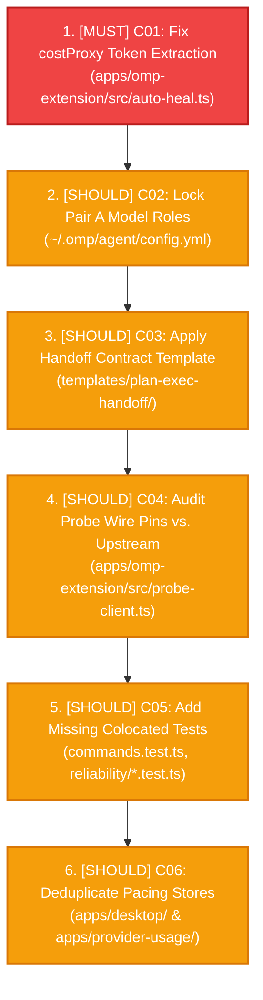

# OMP Toolkit Roadmap (MoSCoW)

> **Beneficiary:** Solo operator (two independent Windows workstations; four providers: Google Antigravity, OpenAI Codex, Muse Code, DeepSeek)  
> **Horizon:** Continuous open backlog (MoSCoW prioritized; strictly one feature or intervention at a time)  
> **Operator Capacity:** ~5 hours/week (~20 hours/month)  
> **Evidence Foundation:** Backed by the empirical research register in [`docs/research/moscow-feature-prioritization.md`](research/moscow-feature-prioritization.md)  

---

## North Star & Operating Principles

All roadmap development is evaluated against these non-negotiable operational principles:

1. **Measurably Better Execution Quality:**
   - North-star metric: `errorEndedRate = agent_run(status="error") / agent_run(all)`. Target: $\ge 25\%$ reduction compared to initial baseline.
   - Cost containment: `costProxy` (mean tokens per non-error run) not degraded by $> 10\%$ relative to baseline.
   - Measurement gate: $\ge 30$ `agent_run` samples present in every evaluation window.
2. **Unwaivable Route Reliability Gate:**
   - 30 consecutive days of zero manual route fixes (`/gemini-enable`, `/gemini-heal`, `/gemini-restore`) across both machines via `bun run reliability:report --days=30 --machine all`.
   - Zero unresolved incidents ($> 15$ minutes) on either workstation.
3. **Core Architectural Invariants:**
   - **Zero Idle Tokens (ADR-0001):** Monitoring performs passive file reads only; no scheduled background probes while the agent is idle.
   - **Two-Machine Independence:** Each workstation operates on local SQLite state (`omp-toolkit-history.db`); zero cross-machine sync or shared networking.
   - **Source-Only Distribution (ADR-0003):** Runs directly from source checkout with Bun; zero public npm publishing or binary distribution overhead.
   - **Pure Domain Boundary:** `packages/core` contains zero filesystem I/O, zero network, zero process calls, and zero ANSI escapes.

---

## Must Have

Critical prerequisites and metric integrity fixes without which daily operation, the reliability proof, or north-star measurement fails.

### Operational Prerequisites (Zero Development)

These operator actions require no codebase modifications and precede feature deployment:

1. **Install Machine 2:** Execute the 7-step checklist in [`docs/runbook.md`](runbook.md#two-machine-rollout) on workstation 2; confirm all-PASS via `bun run doctor`.
2. **Auto-Restore Opt-In:** Run `/gemini-auto-restore <account>` on workstation 1 to initialize `gemini-health-auto-restore.json`, preventing unmanaged lockout from breaking the 30-day proof.
3. **Continuous Monitor Heartbeat:** Run `bun run monitor:orca` as a background process to ensure fresh heartbeat coverage in `reliability:report`.
4. **Baseline Accrual:** Operate normally across both machines for $\ge 14$ consecutive days to accrue $\ge 30$ pooled `agent_run` telemetry records.

### Development Musts

| ID | Feature / Task | Target / Location | Done-Signal | Effort |
| :--- | :--- | :--- | :--- | :---: |
| **`C01`** | **Fix & Validate `costProxy` Token Extraction** | `apps/omp-extension/src/auto-heal.ts:32-67,254-256` | `bun run execution:report --days=14` outputs distinct `tok=<n>` values across sessions of varying length, resolving the constant `tok=1200` anomaly. | M ($5\text{ h}$) |

*Rationale:* In `auto-heal.ts:254-256`, token extraction evaluates `event` and `last`, but `parseLastAssistantMessage` strips `usage`, causing all recorded `agent_run` events to fall back to a fixed `tok=1200`. Until resolved, `costProxy` cannot be trusted for baseline execution quality comparisons.

---

## Should Have

High-leverage execution quality and reliability improvements backed by measured empirical benchmarks or regression prevention.

| ID | Feature / Task | Target / Location | Done-Signal | Effort |
| :--- | :--- | :--- | :--- | :---: |
| **`C02`** | **Lock Pair A Model Roles in User Config** | `~/.omp/agent/config.yml` | `config.yml` contains `deepseek/deepseek-flash` for plan & default with `thinking_level: low`; low cost proxy confirmed in `execution:report`. | S ($1\text{ h}$) |
| **`C03`** | **Apply Handoff Contract Template** | `templates/plan-exec-handoff/` | `/template apply plan-exec-handoff` executed; `AGENTS.md` enforces zero-invention planning and 2-strike verification. | S ($1\text{ h}$) |
| **`C04`** | **Audit Probe Wire Pins vs. Upstream Client** | `apps/omp-extension/src/probe-client.ts:10,17` | `DEFAULT_MODEL_WIRE` and `UA_VERSION` verified against upstream Antigravity client; audit logged in `docs/runbook.md`. | S ($1\text{ h}$) |
| **`C05`** | **Add Missing Colocated Tests for Core Surfaces** | `apps/omp-extension/src/commands.ts` `scripts/reliability/*.ts` | Colocated unit tests for slash commands, `gemini_health` tool, and reliability reporting CLIs pass in `bun run check`. | M ($5\text{ h}$) |
| **`C06`** | **Deduplicate Desktop & CLI Pacing Stores** | `apps/desktop/src/pacing-store.ts` `apps/provider-usage/src/pacing-store.ts` | Single shared store helper extracted outside `packages/core` (preserving core zero-I/O purity); duplicate files removed; `check` passes. | S ($1\text{ h}$) |

*Detailed Rationale:*
- **`C02`:** Empirical 2x2 scorecard (`model-pairing-eval-results.md`) proves Pair A achieves 100% solve rate across tasks T1–T5 at $\$0.02$ cost (vs. $\$0.15+$ for monolithic frontier runs).
- **`C03`:** Prevents executor initiative hallucination, which research documents as causing benchmark solve rates to drop from $36.97\%$ to $23.63\%$ when unconstrained.
- **`C04`:** Verifies `gemini-3.8-flash-high` and `UA_VERSION = "2.24.0"` against Google gateway deprecation.
- **`C05`:** Covers 530 LOC of untested slash command routing in `commands.ts` and reporting math in `execution-report.ts`.
- **`C06`:** Eliminates 88 LOC of duplicate atomic file operations between desktop and terminal CLI.

---

## Could Have

Contingent enhancements, minor ergonomics, and external developer tooling. These are deferred until specific triggers fire or core Shoulds are complete.

| ID | Feature / Task | Target / Location | Contingent Trigger / Condition | Effort |
| :--- | :--- | :--- | :--- | :---: |
| **`C07`** | **Re-Evaluate Model Pairings** | `scripts/eval/eval-model-roles.ts` | Trigger: upstream provider catalog shifts, model deprecations, or pricing restructuring. | S ($1\text{ h}$) |
| **`C08`** | **Targeted Wire-Normalizer Fixes** | `apps/omp-extension/src/gemini-normalizer.ts` | Trigger: an active wire failure reproduced by a failing test in the test suite. | M ($3\text{ h}$) |
| **`C09`** | **Tighten Context-Economy Instructions** | `.omp/AGENTS.md` | Trigger: baseline telemetry reveals error clusters or token bloat tied to specific prompt sections. | S ($1\text{ h}$) |
| **`C10`** | **Programmatic Two-Strike Escalation** | `apps/omp-extension/src/auto-heal.ts` | Trigger: baseline execution report reveals multi-strike retry loop cost spikes. | M ($5\text{ h}$) |
| **`C11`** | **Multi-Account Weekly Pacing** | `packages/core/src/pacing.ts`, `builder.ts` | Convenience: extends pacing ceiling calculation to multi-account sections and non-`muse-code` providers. | M ($3\text{ h}$) |
| **`C12`** | **Cross-Platform OS Incident Toast** | `apps/omp-extension/src/toast.ts` | Ergonomics: adds macOS (`osascript`) and Linux (`notify-send`) notification support for non-Windows environments. | S ($2\text{ h}$) |
| **`C13`** | **Desktop Provider Logo for `muse-code`** | `apps/desktop/src/renderer/provider-logos.ts` | Polish: adds SVG brand logo and mapping for `muse-code` in the desktop widget panel. | S ($1\text{ h}$) |
| **`C14`** | **External Graphify & Repomix Skills** | `skill://graphify` | Tooling: optional external CLI skills for 1M-LOC AST graph retrieval; never bundled as internal repo dependencies. | M ($4\text{ h}$) |

---

## Won't Have (This Backlog)

Explicitly rejected based on empirical refutation, architectural invariants, or roadmap boundaries:

- **`C15`: Reverse Proxy Stream Compression (`billion-context`) — REJECTED.**
  Empirically refuted on 2026-10-29 (`billion-context-evaluation.md`). Produced 0% token savings on agent tasks; hardcoded 50k threshold stayed idle; expanded request payloads by $+8.3\%$ ($+11.1\text{ KiB}$) per turn; breaks byte-stable prefix caching (93–94% hit rate); license attribution conflicts with clean distribution.
- **`C16`: Graphify Inside `packages/core` & In-Process Repo Map — PROHIBITED.**
  Placing Tree-sitter parsing or file indexing into `packages/core` violates pure zero-I/O domain boundaries. Compiler LSP (`xd://lsp`) and `ast-grep outline` already provide deterministic symbol precision at $\sim 50\text{--}150$ tokens per query without persistent indexing overhead.
- **`C17`: Public Packaging, npm Publishing & Signed Binaries — EXCLUDED.**
  Source-only distribution policy (ADR-0003). The solo operator executes directly from git checkouts; public release infrastructure wastes weekly capacity.
- **`C18`: Standalone Web Dashboard Server — EXCLUDED.**
  The desktop Electron tray widget and TerminUI terminal monitor completely satisfy operator observability without maintaining a separate HTTP server process.
- **`C19`: Provider SDK & Generalized Extension Interfaces — EXCLUDED.**
  Purpose-built for OMP; creating generic provider SDK abstractions is dead-weight complexity for a fixed 4-provider deployment.
- **`C20`: Additional Usage Providers (Copilot, Anthropic) — EXCLUDED.**
  Scope is strictly locked to the 4 active providers (Google Antigravity, OpenAI Codex, Muse Code, DeepSeek).
- **`C21`: Cross-Platform Reliability Proof Parity — EXCLUDED.**
  The 30-day zero-manual-fix reliability proof is strictly scoped to two Windows workstations (ADR-0004). macOS and Linux remain maintain-only best-effort.
- **`C22`: Periodic Background Idle Route Probing — PROHIBITED.**
  Probing routes while no session is active wastes provider token quotas, violating the zero-idle-token invariant (ADR-0001).
- **`C23`: Cross-Machine State Synchronization & Distributed DB — PROHIBITED.**
  Violates the two-machine independence invariant. Workstations maintain isolated local SQLite databases without network synchronization.
- **`C24`: Lower-Model Fallback or Thinking Degradation on Error — PROHIBITED.**
  Silently falling back to weaker models or reducing thinking levels during errors degrades code quality. Route circuit breaking and auto-restore are the sole authorized remedies.

---

## Recommended Execution Sequence

Development proceeds strictly one item at a time in the following priority order:

1. **`[MUST]` Fix & Validate `costProxy` Token Extraction (`C01`)**
   - *Target:* `apps/omp-extension/src/auto-heal.ts:32-67,254-256`.
   - *Action:* Inspect raw `agent_end` event payload to capture actual token totals (`totalTokens`, or `inputTokens + outputTokens`) before falling back to `last` message details.
   - *Done Signal:* `bun run execution:report --days=14` outputs distinct `tok=<n>` values across sessions of varying length, resolving constant `tok=1200` output.
2. **`[SHOULD]` Lock Pair A Model Roles in User Config (`C02`)**
   - *Target:* `~/.omp/agent/config.yml`.
   - *Action:* Set `modelRoles: { plan: "deepseek/deepseek-flash", default: "deepseek/deepseek-flash" }` with executor `thinking_level: low`.
   - *Done Signal:* Subsequent test sessions log `provider = deepseek` in `omp-toolkit-history.db` with expected low latency and cost.
3. **`[SHOULD]` Apply Plan-to-Executor Handoff Contract Template (`C03`)**
   - *Target:* `~/.omp/agent/AGENTS.md`.
   - *Action:* Run `/template apply plan-exec-handoff` inside OMP.
   - *Done Signal:* `~/.omp/agent/AGENTS.md` matches `templates/plan-exec-handoff/AGENTS.template.md`, activating zero-invention planning and 2-strike verification.
4. **`[SHOULD]` Audit Probe Wire Pins vs. Upstream Antigravity Client (`C04`)**
   - *Target:* `apps/omp-extension/src/probe-client.ts:10,17`.
   - *Action:* Verify `DEFAULT_MODEL_WIRE = "gemini-3.8-flash-high"` and `UA_VERSION = "2.24.0"` against the upstream OMP client release.
   - *Done Signal:* Audit record logged in `docs/runbook.md`; updated pins committed if changed.
5. **`[SHOULD]` Add Missing Colocated Tests for Core Surfaces (`C05`)**
   - *Target:* `apps/omp-extension/src/commands.test.ts`, `scripts/reliability/execution-report.test.ts`, `scripts/reliability/reliability-report.test.ts`.
   - *Action:* Implement deterministic unit tests covering command registration, error boundaries, argument parsing, and report table output.
   - *Done Signal:* `bun run check` executes all new test suites with 100% pass rate.
6. **`[SHOULD]` Deduplicate Desktop & CLI Pacing Stores (`C06`)**
   - *Target:* Shared adapter utility outside `packages/core`.
   - *Action:* Extract common `writeFileAtomic` and `recordAndLoadPacingSamples` logic without violating `packages/core` purity.
   - *Done Signal:* Duplicate files in `apps/desktop/` and `apps/provider-usage/` removed; both import shared helper; `bun run check` passes.

---

## Operating Cadence

To maintain reliability and track execution quality without administrative overhead:

- **Monday (15 minutes):**
  - Run `bun run reliability:report --days=7`.
  - Run `bun run execution:report --days=7`.
  - Select at most one fix or intervention from the sequence above for the week.
  - Append report metrics and keep/revert decisions to the machine-local weekly review note.
- **Friday (10 minutes):**
  - Confirm `monitor-age` is fresh on both workstations.
  - Backup history database: copy `omp-toolkit-history.db` to `~/.omp/agent/backups/history-<YYYY-MM-DD>.db`.
- **Incident Response:**
  - Run `bun run doctor`.
  - Read monitor `INCIDENT` banner.
  - Never edit routing policies by hand; let the circuit breaker and recovery timer handle restoration.
